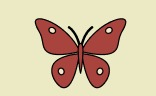
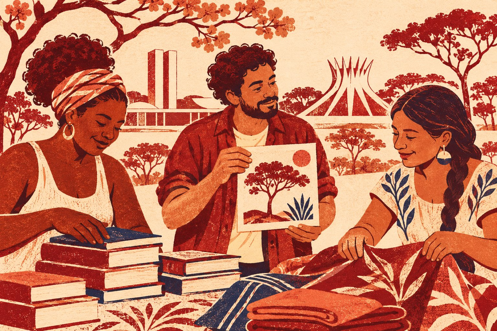

# Guaramo Solidário — Brasília, DF

## Como abrir

Extraia o ZIP, abra um terminal na pasta extraída e execute `python -m http.server 8000 --bind 127.0.0.1`. No navegador, abra `http://127.0.0.1:8000/`. Use o mesmo endereço para compartilhar os registros locais entre páginas.

## Caminhos do site

- **Para migrantes** reúne chegada, emprego, estoque, revalidação de diploma e apoio psicológico. A página de Empregos traz fontes públicas de vagas e um gerador de currículo em português.
- **Quero ser voluntário** oferece apenas frentes voluntárias e o formulário correspondente.
- **Quero apoiar a rede** reúne doações, oferta de trabalho e parcerias.
- **Cultura** reúne obras, envio para avaliação e agenda. A página de apoio psicológico abre a agenda filtrada por rodas de conversa.

## Como operar o painel

Abra **Administração** pelo rodapé.

- Em **Gerenciar vagas**, publique, edite, oculte, republique ou remova vagas. A listagem aparece em Empregos.
- Envie um poema ou link HTTPS de obra por **Cultura**. Em **Moderar obras**, aprove para publicar, recuse, retire da mostra ou remova o registro.
- Em **Gerenciar agenda**, cadastre, edite, oculte ou remova atividades. Use o tipo **Roda de conversa** para incluí-las na agenda filtrada do Apoio psicológico.
- Controle quantidades e transferências entre os cinco pontos no **Estoque** e revise os registros de participação e trabalho.

O painel ainda funciona no navegador e não tem autenticação. Dados e publicações ficam na origem local usada durante o teste. O site não recebe agendamentos nem relatos de saúde.

## Código-fonte

### index.html

```html
<!doctype html>
<html lang="pt-BR">
<head>
  <meta charset="utf-8">
  <meta name="viewport" content="width=device-width, initial-scale=1">
  <meta name="description" content="Rede de apoio a pessoas migrantes e refugiadas em Brasília, no Distrito Federal." data-i18n-content="description">
  <title data-i18n-title="home">Início | Guaramo Solidário</title>
  <link rel="stylesheet" href="./style.css">
  <script src="./main.js" defer></script>
</head>
<body>
  <a href="#conteudo" class="skip-link" data-i18n="skip">Pular para o conteúdo</a>
  <header class="site-header">
    <div class="wrap header-row">
      <a class="brand" href="./index.html">
        
        <span aria-hidden="true">Guaramo Solidário</span>
      </a>
      <!-- Os botões aparecem quando o script de tradução está pronto. -->
      <div class="languages" role="group" aria-label="Idioma" data-i18n-label="language" hidden>
        <button type="button" lang="pt-BR" data-lang="pt" aria-pressed="true">Português</button>
        <button type="button" lang="es" data-lang="es" aria-pressed="false">Español</button>
      </div>
      <nav aria-label="Navegação principal" data-i18n-label="nav">
        <a href="./index.html" aria-current="page" data-i18n="home">Início</a>
        <a href="./migrantes.html" data-i18n="migrant-nav">Para migrantes</a>
        <a href="./voluntarios.html" data-i18n="volunteer-path">Quero ser voluntário</a>
        <a href="./ajudar.html" data-i18n="partner">Quero apoiar a rede</a>
        <a href="./cultura.html" data-i18n="culture">Cultura</a>
      </nav>
    </div>
  </header>

  <main id="conteudo" tabindex="-1">
    <!-- Vitrine. As chamadas levam a documentos HTML independentes. -->
    <section class="hero">
      <div class="wrap hero-grid">
        <div>
          <p class="overline" data-i18n="tagline">BRASÍLIA, DF · ACOLHIMENTO E INTEGRAÇÃO</p>
          <h1 data-i18n="hero-title">Recomeçar em Brasília fica mais fácil em rede.</h1>
          <p class="intro" data-i18n="hero-copy">A Guaramo Solidário é uma rede de acolhimento e integração para pessoas migrantes e refugiadas no Distrito Federal. Encontre orientações para quem está chegando e conheça o trabalho da rede.</p>
          <div class="actions"><a href="#caminhos" class="button primary" data-i18n="start-button">Escolher meu caminho</a></div>
        </div>
        <figure class="hero-figure">
          
          <figcaption data-i18n="illustration-caption">Acolhimento, arte e trabalho em Brasília</figcaption>
        </figure>
      </div>
    </section>

    <section class="wrap section" id="caminhos" aria-labelledby="start-title">
      <h2 id="start-title" data-i18n="start-title">Como podemos ajudar você?</h2>
      <div class="route-grid">
        <article class="card route-card"><a href="./migrantes.html" class="route-link" data-i18n="migrant">Sou imigrante ou refugiado</a><p data-i18n="migrant-copy">Encontre orientações para chegar a Brasília, buscar trabalho e acessar apoio.</p></article>
        <article class="card route-card"><a href="./voluntarios.html" class="route-link" data-i18n="volunteer-path">Quero ser voluntário</a><p data-i18n="volunteer-path-copy">Veja as frentes de voluntariado e escolha onde quer colaborar.</p></article>
        <article class="card route-card"><a href="./ajudar.html" class="route-link" data-i18n="partner">Quero apoiar a rede</a><p data-i18n="partner-copy">Encontre opções para doar, oferecer uma vaga ou propor uma parceria.</p></article>
        <article class="card route-card"><a href="./cultura.html" class="route-link" data-i18n="culture-path">Quero participar da cultura</a><p data-i18n="culture-path-copy">Conheça a mostra virtual, veja a agenda e envie uma obra para avaliação.</p></article>
      </div>
    </section>

<section class="wrap section support-grid" aria-labelledby="rede-local">
      <div class="local-intro">
        <p class="overline" data-i18n="local-kicker">A REDE NO DISTRITO FEDERAL</p>
        <h2 id="rede-local" data-i18n="local-title">Acolhimento na prática</h2>
        <p class="section-copy" data-i18n="local-copy">A Guaramo Solidário atua com pessoas migrantes e refugiadas no Distrito Federal. Em parceria com o Instituto Promundo, a rede criou a Cartilha Andanças com a participação de pessoas que vivem a experiência da migração.</p>
        <a href="https://www.acnur.org/br/noticias/comunicados-imprensa/sessao-solene-celebra-dia-mundial-do-refugiado-no-congresso-nacional" class="text-link" data-i18n="local-source">Conhecer a rede no ACNUR</a>
      </div>
      <article class="card support-card">
        <h3 data-i18n="guide-title">Cartilha Andanças</h3>
        <p data-i18n="guide-copy">Um guia para quem está chegando ao DF, com orientações sobre documentação, moradia, educação, saúde e trabalho.</p>
        <a href="https://promundo.org.br/cartilha-andancas/" class="button primary" data-i18n="guide-link">Consultar a Cartilha Andanças</a>
      </article>
    </section>

    <div class="wrap">
      <article class="card" id="historia-da-rede" aria-labelledby="historia-titulo">
        <p class="overline" data-i18n="press-kicker">NA IMPRENSA</p>
        <h2 id="historia-titulo" data-i18n="press-title">Como nasceu a Guaramo Solidário</h2>
        <p data-i18n="press-origin">Durante a pandemia, a artista e professora venezuelana Damelis Castillo começou a conectar famílias recém-chegadas ao Distrito Federal com pessoas dispostas a doar alimentos e roupas. Amigos ajudavam nas entregas. Com o tempo, famílias acolhidas passaram a orientar quem acabava de chegar e a compartilhar oportunidades de trabalho.</p>
        <p data-i18n="press-history">Em julho de 2021, o Correio Braziliense registrou que a rede apoiava cerca de 270 famílias.</p>
        <p><cite>Correio Braziliense</cite> · <time datetime="2021-07-10" data-i18n="press-date">10 de julho de 2021</time></p>
        <a class="button" href="https://www.correiobraziliense.com.br/cidades-df/2021/07/4936666-imigrantes-recomecam-a-vida-no-df-com-assistencia-e-trabalho.html" data-i18n="press-link">Ler a reportagem no Correio Braziliense</a>
      </article>
    </div>


  </main>

  <footer class="site-footer">
    <div class="wrap">
      <strong>Guaramo Solidário</strong>
      <p data-i18n="footer">Rede de acolhimento em Brasília, DF</p>
      <div class="footer-links">
        <a href="./eventos.html" class="text-link" data-i18n="events">Eventos</a>
        <a href="./contatos.html" class="text-link" data-i18n="contacts">Contatos</a>
        <a href="./admin.html" class="text-link" data-i18n="admin">Administração</a>
      </div>
    </div>
  </footer>
</body>
</html>
```

### migrantes.html

```html
<!doctype html>
<html lang="pt-BR">
<head>
  <meta charset="utf-8">
  <meta name="viewport" content="width=device-width, initial-scale=1">
  <meta name="description" content="Rede de apoio a pessoas migrantes e refugiadas em Brasília, no Distrito Federal." data-i18n-content="description">
  <title data-i18n-title="migrant-nav">Para migrantes | Guaramo Solidário</title>
  <link rel="stylesheet" href="./style.css">
  <script src="./main.js" defer></script>
  <script src="./community.js" defer></script>
</head>
<body>
  <a href="#conteudo" class="skip-link" data-i18n="skip">Pular para o conteúdo</a>
  <header class="site-header">
    <div class="wrap header-row">
      <a class="brand" href="./index.html">
        
        <span aria-hidden="true">Guaramo Solidário</span>
      </a>
      <!-- Os botões aparecem quando o script de tradução está pronto. -->
      <div class="languages" role="group" aria-label="Idioma" data-i18n-label="language" hidden>
        <button type="button" lang="pt-BR" data-lang="pt" aria-pressed="true">Português</button>
        <button type="button" lang="es" data-lang="es" aria-pressed="false">Español</button>
      </div>
      <nav aria-label="Navegação principal" data-i18n-label="nav">
        <a href="./index.html" data-i18n="home">Início</a>
        <a href="./migrantes.html" aria-current="page" data-i18n="migrant-nav">Para migrantes</a>
        <a href="./voluntarios.html" data-i18n="volunteer-path">Quero ser voluntário</a>
        <a href="./ajudar.html" data-i18n="partner">Quero apoiar a rede</a>
        <a href="./cultura.html" data-i18n="culture">Cultura</a>
      </nav>
    </div>
  </header>

  <main id="conteudo" tabindex="-1">
    <div class="wrap section subpage">
      <h1 data-i18n="migrant">Sou imigrante ou refugiado</h1>
      <p class="intro" data-i18n="migrant-intro">Escolha o apoio de que precisa hoje. Cada opção leva a uma página com orientações ou recursos para o seu próximo passo no Distrito Federal.</p>
      <div class="cards">
        <article class="card"><h2 data-i18n="arrival">Chegada e primeiros passos</h2><p data-i18n="arrival-copy">Consulte a Cartilha Andanças para se orientar sobre documentação, educação, moradia e serviços.</p><a href="https://promundo.org.br/cartilha-andancas/" class="text-link" data-i18n="guide-link">Consultar a Cartilha Andanças</a></article>
        <article class="card"><h2 data-i18n="jobs">Empregos</h2><p data-i18n="jobs-home">Consulte vagas no DF, organize seu currículo e encontre orientação para começar a trabalhar.</p><a href="./empregos.html" class="text-link" data-i18n="jobs-home-link">Buscar vagas e preparar currículo</a></article>
        <article class="card"><h2 data-i18n="support">Apoio psicológico</h2><p data-i18n="migrant-support">Veja os formatos de acolhimento e encontre a rede pública de saúde mental.</p><a href="./apoio.html" class="text-link" data-i18n="support">Apoio psicológico</a></article>
        <article class="card"><h2 data-i18n="donations">Doações</h2><p data-i18n="migrant-donation">Veja os tipos de itens e a situação dos pontos de apoio.</p><a href="./doacoes.html#estoque" class="text-link" data-i18n="inventory-public">Estoque por ponto de apoio</a></article>
        <article class="card"><h2 data-i18n="menu-diploma">Revalidação de Diploma</h2><p data-i18n="jobs-diploma-text">Estudou em outro país? Consulte o serviço oficial para saber como funciona a revalidação de diplomas de ensino superior.</p><a class="text-link" href="https://www.gov.br/pt-br/servicos/reconhecer-ou-revalidar-diploma-de-curso-superior-obtido-no-exterior" target="_blank" rel="noopener noreferrer"><span data-i18n="menu-diploma">Revalidação de Diploma</span><span class="sr-only" data-i18n="new-tab">(abre em nova aba)</span></a></article>
      </div>
      <section class="stack" id="participar">
        <h2 data-i18n="work-register">Registrar necessidade de trabalho</h2><p class="section-copy" data-i18n="interest-note">O registro fica neste navegador e ainda não é enviado à equipe. Evite incluir dados pessoais ou de saúde.</p>
        <form class="card form-card" id="interest-form" hidden>
          <div class="cv-field"><label for="interest-name" data-i18n="sample-name">Nome para identificação</label><input id="interest-name" name="name" maxlength="60" required></div>
          <div class="cv-field"><label for="interest-area" data-i18n="interest-area">Motivo do registro</label>
          <select id="interest-area" name="area" required><option value="" data-i18n="choose">Selecione uma opção</option><option value="work-search" data-i18n="work-search">Procurar trabalho</option><option value="work-profile" data-i18n="work-profile">Incluir meu perfil</option></select></div>
          <div class="cv-field"><label for="work-details" data-i18n="work-details">Área, serviço ou tipo de apoio (opcional)</label><input id="work-details" name="details" maxlength="120"></div>
          <button type="submit" class="button primary" data-i18n="interest-save">Registrar interesse</button>
        </form><p id="interest-status" class="status" role="status"></p>
      </section>
    </div>
  </main>

  <footer class="site-footer">
    <div class="wrap">
      <strong>Guaramo Solidário</strong>
      <p data-i18n="footer">Rede de acolhimento em Brasília, DF</p>
      <div class="footer-links">
        <a href="./eventos.html" class="text-link" data-i18n="events">Eventos</a>
        <a href="./contatos.html" class="text-link" data-i18n="contacts">Contatos</a>
        <a href="./admin.html" class="text-link" data-i18n="admin">Administração</a>
      </div>
    </div>
  </footer>
</body>
</html>
```

### apoio.html

```html
<!doctype html>
<html lang="pt-BR">
<head>
  <meta charset="utf-8">
  <meta name="viewport" content="width=device-width, initial-scale=1">
  <meta name="description" content="Rede de apoio a pessoas migrantes e refugiadas em Brasília, no Distrito Federal." data-i18n-content="description">
  <title data-i18n-title="support">Apoio psicológico | Guaramo Solidário</title>
  <link rel="stylesheet" href="./style.css">
  <script src="./main.js" defer></script>
</head>
<body>
  <a href="#conteudo" class="skip-link" data-i18n="skip">Pular para o conteúdo</a>
  <header class="site-header">
    <div class="wrap header-row">
      <a class="brand" href="./index.html">
        
        <span aria-hidden="true">Guaramo Solidário</span>
      </a>
      <!-- Os botões aparecem quando o script de tradução está pronto. -->
      <div class="languages" role="group" aria-label="Idioma" data-i18n-label="language" hidden>
        <button type="button" lang="pt-BR" data-lang="pt" aria-pressed="true">Português</button>
        <button type="button" lang="es" data-lang="es" aria-pressed="false">Español</button>
      </div>
      <nav aria-label="Navegação principal" data-i18n-label="nav">
        <a href="./index.html" data-i18n="home">Início</a>
        <a href="./migrantes.html" data-i18n="migrant-nav">Para migrantes</a>
        <a href="./voluntarios.html" data-i18n="volunteer-path">Quero ser voluntário</a>
        <a href="./ajudar.html" data-i18n="partner">Quero apoiar a rede</a>
        <a href="./cultura.html" data-i18n="culture">Cultura</a>
      </nav>
    </div>
  </header>

  <main id="conteudo" tabindex="-1">
    <div class="wrap section subpage">
      <h1 data-i18n="support">Apoio psicológico</h1><p class="intro" data-i18n="psych-intro">Conheça as atividades que a Guaramo está organizando e saiba onde procurar atendimento no Distrito Federal.</p>
      <p class="demo" data-i18n="psych-state">As atividades da Guaramo estão em organização. Esta página ainda não recebe agendamentos nem relatos de saúde.</p>
      <div class="cards">
        <article class="card"><h2 data-i18n="circles">Rodas de conversa</h2><p data-i18n="circles-copy">Encontros em grupo para conversar sobre a chegada, a saudade, os idiomas e o cotidiano em Brasília. Cada pessoa pode participar no seu ritmo.</p><a href="./eventos.html?tipo=roda" class="text-link" data-i18n="circles-link">Acompanhar a agenda</a></article>
        <article class="card"><h2 data-i18n="psychologist">Acolhimento com psicóloga</h2><p data-i18n="psychologist-copy">A proposta é oferecer um primeiro encontro individual com uma psicóloga para escuta e orientação sobre possibilidades de acompanhamento. Horários e equipe ainda precisam ser confirmados.</p><a href="#rede-publica" class="text-link" data-i18n="public-mental-link">Consultar a rede de saúde mental do DF</a></article>
        <article class="card"><h2 data-i18n="online-listening">Escuta online supervisionada</h2><p data-i18n="online-copy">Frente em organização com universidades e profissionais. A participação de estudantes dependerá de supervisão profissional.</p><a href="./voluntarios.html?area=help-listening#participar" class="text-link" data-i18n="help-listening">Colaborar com a escuta online</a></article>
      </div>
      <section class="card stack" id="rede-publica">
        <h2 data-i18n="public-mental">Atendimento pela rede pública</h2><p data-i18n="public-mental-copy">Consulte a página da Secretaria de Saúde do DF para localizar os serviços da rede de atenção psicossocial.</p>
        <a href="https://info.saude.df.gov.br/busca-saude-caps/" class="button primary" data-i18n="public-mental-link">Consultar a rede de saúde mental do DF</a>
      </section>
    </div>
  </main>

  <footer class="site-footer">
    <div class="wrap">
      <strong>Guaramo Solidário</strong>
      <p data-i18n="footer">Rede de acolhimento em Brasília, DF</p>
      <div class="footer-links">
        <a href="./eventos.html" class="text-link" data-i18n="events">Eventos</a>
        <a href="./contatos.html" class="text-link" data-i18n="contacts">Contatos</a>
        <a href="./admin.html" class="text-link" data-i18n="admin">Administração</a>
      </div>
    </div>
  </footer>
</body>
</html>
```

### admin.html

```html
<!doctype html>
<html lang="pt-BR">
<head>
  <meta charset="utf-8">
  <meta name="viewport" content="width=device-width, initial-scale=1">
  <meta name="description" content="Rede de apoio a pessoas migrantes e refugiadas em Brasília, no Distrito Federal." data-i18n-content="description">
  <title data-i18n-title="admin">Administração | Guaramo Solidário</title>
  <link rel="stylesheet" href="./style.css">
  <script src="./main.js" defer></script>
  <script src="./community.js" defer></script>
  <script src="./gestao.js" defer></script>
</head>
<body>
  <a href="#conteudo" class="skip-link" data-i18n="skip">Pular para o conteúdo</a>
  <header class="site-header">
    <div class="wrap header-row">
      <a class="brand" href="./index.html">
        
        <span aria-hidden="true">Guaramo Solidário</span>
      </a>
      <!-- Os botões aparecem quando o script de tradução está pronto. -->
      <div class="languages" role="group" aria-label="Idioma" data-i18n-label="language" hidden>
        <button type="button" lang="pt-BR" data-lang="pt" aria-pressed="true">Português</button>
        <button type="button" lang="es" data-lang="es" aria-pressed="false">Español</button>
      </div>
      <nav aria-label="Navegação principal" data-i18n-label="nav">
        <a href="./index.html" data-i18n="home">Início</a>
        <a href="./migrantes.html" data-i18n="migrant-nav">Para migrantes</a>
        <a href="./voluntarios.html" data-i18n="volunteer-path">Quero ser voluntário</a>
        <a href="./ajudar.html" data-i18n="partner">Quero apoiar a rede</a>
        <a href="./cultura.html" data-i18n="culture">Cultura</a>
      </nav>
    </div>
  </header>

  <main id="conteudo" tabindex="-1">
    <div class="wrap section subpage">
      <h1 data-i18n="admin">Administração</h1>
      <p class="intro" data-i18n="admin-lead">Gerencie o que aparece no site e acompanhe os registros da rede.</p>
      <p class="demo" data-i18n="admin-note">Painel local, sem autenticação. Os registros ficam neste navegador. Evite usar dados pessoais.</p>
      <details class="management-panel"><summary data-i18n="inventory-title">Controle de estoque</summary><section class="stack" id="controle"><h2 data-i18n="inventory-title">Controle de estoque</h2>
        <form class="card form-card" id="stock-form" hidden>
          <label for="stock-point" data-i18n="point-label">Ponto de coleta</label><select id="stock-point" name="point" required><option value="north" data-i18n="point-north">Ponto de apoio 01</option><option value="center" data-i18n="point-center">Ponto de apoio 02</option><option value="east" data-i18n="point-east">Ponto de apoio 03</option><option value="south" data-i18n="point-south">Ponto de apoio 04</option><option value="west" data-i18n="point-west">Ponto de apoio 05</option></select>
          <label for="stock-item" data-i18n="item-label">Nome do item</label><input id="stock-item" name="item" maxlength="80" required>
          <label for="stock-qty" data-i18n="qty-label">Quantidade</label><input id="stock-qty" name="quantity" type="number" min="0" max="99999" step="1" required>
          <button class="button primary" type="submit" data-i18n="add-item">Cadastrar item</button>
        </form>
        <p class="status" id="stock-status" role="status"></p>

        <form class="card form-card" id="transfer-form" hidden>
          <h3 data-i18n="transfer-title">Distribuir itens entre pontos</h3>
          <label for="transfer-source" data-i18n="transfer-source">Item e ponto de origem</label>
          <select id="transfer-source" name="source" required></select>
          <label for="transfer-dest" data-i18n="transfer-to">Ponto de destino</label>
          <select id="transfer-dest" name="destination" required></select>
          <label for="transfer-qty" data-i18n="qty-label">Quantidade</label>
          <input id="transfer-qty" name="quantity" type="number" min="1" max="99999" step="1" required>
          <button type="submit" class="button primary" data-i18n="transfer-do">Transferir</button>
        </form>
        <p class="status" id="transfer-status" role="status"></p>
        <div id="inventory" class="cards"></div>
        <noscript><p data-i18n="stock-js">Ative o JavaScript para consultar o estoque por ponto.</p></noscript>
      </section></details>
      <details class="management-panel"><summary data-i18n="interests-title">Registros de participação e trabalho</summary><section class="stack" id="interesses"><h2 tabindex="-1" data-i18n="interests-title">Registros de participação e trabalho</h2><p class="status" id="admin-interest-status" role="status"></p>
        <ul id="interests" class="plain-list"></ul>
      </section></details>
      <details class="management-panel" id="gestao-vagas">
        <summary data-i18n="admin-jobs">Gerenciar vagas</summary>
        <form class="card form-card" id="jobs-form" hidden>
        <div class="cv-field"><label for="job-title" data-i18n="job-title">Cargo</label><input id="job-title" name="title" maxlength="100" required></div>
        <div class="cv-field"><label for="job-company" data-i18n="job-company">Organização</label><input id="job-company" name="company" maxlength="100" required></div>
        <div class="cv-field"><label for="job-region" data-i18n="job-region">Localidade ou trabalho remoto</label><input id="job-region" name="region" maxlength="100" required></div>
        <div class="cv-field"><label for="job-description" data-i18n="job-description">Descrição e requisitos</label><textarea id="job-description" name="description" rows="3" maxlength="800" required></textarea></div>
        <div class="cv-field"><label for="job-url" data-i18n="job-url">Link HTTPS para candidatura</label><input id="job-url" name="url" type="url" maxlength="600" required></div>
        <div class="resource-actions"><button type="submit" class="button primary" data-i18n="publish">Publicar</button><button type="button" class="button" data-cancel hidden data-i18n="cancel-edit">Cancelar edição</button></div>
      </form><p id="jobs-status" class="status" role="status"></p><ul id="jobs-admin" class="plain-list management-list"></ul>
      </details>
      <details class="management-panel" id="gestao-obras">
        <summary data-i18n="admin-arts">Moderar obras</summary>
        <p id="arts-admin-status" class="status" role="status"></p>
        <ul id="arts-admin" class="plain-list management-list"></ul>
      </details>
      <details class="management-panel" id="gestao-agenda">
        <summary data-i18n="admin-events">Gerenciar agenda</summary>
        <form class="card form-card" id="calendar-form" hidden>
        <div class="cv-field"><label for="event-kind" data-i18n="event-kind">Tipo de atividade</label><select id="event-kind" name="kind" required><option value="general" data-i18n="event-general">Atividade da rede</option><option value="circle" data-i18n="event-circle">Roda de conversa</option></select></div>
        <div class="cv-field"><label for="event-title" data-i18n="event-title">Nome da atividade</label><input id="event-title" name="title" maxlength="100" required></div>
        <div class="cv-field"><label for="event-when" data-i18n="event-when">Data e hora em Brasília</label><input id="event-when" name="when" type="datetime-local" required></div>
        <div class="cv-field"><label for="event-place" data-i18n="event-place">Local ou formato</label><input id="event-place" name="place" maxlength="140" required></div>
        <div class="cv-field"><label for="event-description" data-i18n="event-desc">Descrição da atividade</label><textarea id="event-description" name="description" rows="3" maxlength="800" required></textarea></div>
        <div class="cv-field"><label for="event-url" data-i18n="event-url">Link HTTPS com detalhes (opcional)</label><input id="event-url" name="url" type="url" maxlength="600"></div>
        <div class="resource-actions"><button type="submit" class="button primary" data-i18n="publish">Publicar</button><button type="button" class="button" data-cancel hidden data-i18n="cancel-edit">Cancelar edição</button></div>
      </form><p id="calendar-status" class="status" role="status"></p><ul id="calendar-admin" class="plain-list management-list"></ul>
      </details>
    </div>
  </main>

  <footer class="site-footer">
    <div class="wrap">
      <strong>Guaramo Solidário</strong>
      <p data-i18n="footer">Rede de acolhimento em Brasília, DF</p>
      <div class="footer-links">
        <a href="./eventos.html" class="text-link" data-i18n="events">Eventos</a>
        <a href="./contatos.html" class="text-link" data-i18n="contacts">Contatos</a>
        <a href="./admin.html" aria-current="page" class="text-link" data-i18n="admin">Administração</a>
      </div>
    </div>
  </footer>
</body>
</html>
```

### style.css

```css
/* Base mobile-first e paleta compartilhada pelas quatro páginas. */
:root {
  color-scheme: light;
  --paper: #f8f3e7;
  --surface: #fffaf1;
  --tint: #eee4d1;
  --ink: #251b18;
  --muted: #514039;
  --red: #702321;
  --red-hover: #501613;
  --line: #9a776b;
  --focus: #143d71;
  font-family: Inter, system-ui, -apple-system, "Segoe UI", sans-serif;
}

*, *::before, *::after { box-sizing: border-box; }
[hidden] { display: none !important; }
body { margin: 0; color: var(--ink); background: var(--paper); line-height: 1.6; }
img { display: block; max-inline-size: 100%; }
h1, h2, h3, p { margin: 0; }
h1, h2, h3 { line-height: 1.13; text-wrap: balance; }
h1 { max-inline-size: 17ch; font-size: clamp(2.35rem, 7vw, 4.75rem); letter-spacing: -.045em; }
h2 { font-size: clamp(1.6rem, 4vw, 2.6rem); letter-spacing: -.025em; }
h3, .cards h2 { font-size: 1.35rem; letter-spacing: 0; }
a { color: var(--red); text-underline-offset: .24em; }
button { font: inherit; cursor: pointer; }
a, button {
  display: inline-flex;
  align-items: center;
  min-block-size: 44px;
  min-inline-size: 44px;
}
:focus {
  outline: 3px solid var(--focus);
  outline-offset: 3px;
  box-shadow: 0 0 0 3px var(--surface);
}
.wrap { inline-size: min(100% - 2rem, 72rem); margin-inline: auto; }

.sr-only, .skip-link:not(:focus) {
  position: absolute;
  inline-size: 1px;
  block-size: 1px;
  min-inline-size: 0;
  min-block-size: 0;
  padding: 0;
  overflow: hidden;
  clip-path: inset(50%);
  white-space: nowrap;
}
.skip-link:focus {
  position: absolute;
  z-index: 2;
  inset: .5rem auto auto .5rem;
  padding-inline: 1rem;
  background: var(--surface);
}

/* Cabeçalho com navegação visível também em telas estreitas. */
.site-header { background: var(--surface); border-bottom: 1px solid var(--line); }
.header-row { display: flex; flex-wrap: wrap; align-items: center; gap: .5rem 1rem; padding-block: .65rem; }
.brand { gap: .65rem; color: var(--ink); font-weight: 800; text-decoration: none; }
.brand img { object-fit: contain; }
nav, .languages, .actions { display: flex; flex-wrap: wrap; gap: .25rem .5rem; }
nav { inline-size: 100%; }
nav a, .languages button { border-radius: .4rem; padding: .35rem .6rem; font-weight: 700; }
nav a { gap: .35em; }
nav a[aria-current="page"], nav a:hover { background: var(--tint); }
.languages { margin-inline-start: auto; }
.languages button { border: 1px solid var(--red); color: var(--red); background: var(--surface); }

.hero { background: var(--tint); }
.hero-grid { display: grid; align-items: center; gap: 2rem; padding-block: clamp(2.75rem, 7vw, 6rem); }
.overline { color: var(--red); font-size: .79rem; font-weight: 800; letter-spacing: .09em; }
.overline + h1, .overline + h2 { margin-block-start: .55rem; }
.intro, .section-copy { max-inline-size: 61ch; color: var(--muted); margin-block-start: .8rem; }
.intro { font-size: 1.125rem; }
.actions { gap: .8rem; margin-block-start: 1.4rem; }
.button {
  justify-content: center;
  gap: .5em;
  padding: .55rem 1rem;
  border: 1px solid var(--red);
  border-radius: .5rem;
  background: var(--surface);
  font-weight: 750;
  text-decoration: none;
}
.button:hover { background: var(--tint); text-decoration: underline; }
.primary, .languages button[aria-pressed="true"] { color: var(--surface); background: var(--red); }
.primary:hover, .languages button[aria-pressed="true"]:hover { background: var(--red-hover); }

.hero-figure { margin: 0; overflow: hidden; border: 1px solid var(--line); border-radius: 1rem; background: var(--surface); }
.hero-figure img { inline-size: 100%; block-size: auto; aspect-ratio: 3 / 2; object-fit: cover; }
.hero-figure figcaption { padding: .6rem .9rem; color: var(--muted); font-size: .9rem; }

.demo { padding-block: .85rem; color: var(--muted); font-size: .92rem; border-bottom: 1px solid var(--line); }
.section { padding-block: clamp(2rem, 5vw, 4rem); }
.band { background: var(--tint); }
.cards, .support-grid { display: grid; grid-template-columns: minmax(0, 1fr); gap: 1rem; }
.cards { margin-block: 1.5rem; }
.card {
  display: flex;
  flex-direction: column;
  align-items: start;
  gap: .7rem;
  padding: 1.25rem;
  border: 1px solid var(--line);
  border-radius: .8rem;
  background: var(--surface);
}
.card p:not(.overline) { color: var(--muted); }
.stock-number { color: var(--red); font-size: 1.6rem; font-weight: 800; }
.profile img { border-radius: 50%; object-fit: cover; background: var(--tint); }
.profile:target { outline: 3px solid var(--red); outline-offset: 3px; }
.text-link { gap: .35em; margin-block-start: auto; font-weight: 750; }
.support-card .button { margin-block-start: auto; }
.support-card:first-child { background: var(--tint); }
.subpage .demo { margin-block: 1.25rem; }
.demo-address { overflow-wrap: anywhere; }
.site-footer { padding-block: 1.5rem; background: var(--tint); border-top: 1px solid var(--line); }

@media (min-width: 42rem) {
  .hero-grid { grid-template-columns: 1.4fr 1fr; }
  .cards { grid-template-columns: repeat(3, minmax(0, 1fr)); }
  .support-grid { grid-template-columns: repeat(2, minmax(0, 1fr)); }
}
@media (min-width: 70rem) {
  nav { inline-size: auto; }
}
@media (forced-colors: active) {
  :focus { outline-color: Highlight; }
  .languages button[aria-pressed="true"] { border: 2px solid Highlight; }
}

.local-intro .text-link { margin-block-start: .5rem; }
.public-resource { margin-block-start: 1.5rem; }
.resource-actions { display: flex; flex-wrap: wrap; gap: .75rem; }

/* Cultura, formulários e controles do painel local. */
.artwork {
  position: relative;
  overflow: hidden;
  inline-size: 100%;
  min-block-size: 10rem;
  border-radius: .6rem;
  background: #183951;
  isolation: isolate;
}
.artwork::before, .artwork::after, .artwork span { position: absolute; content: ""; }
.artwork::before { inset: 12% 12% auto auto; inline-size: 25%; aspect-ratio: 1; border-radius: 50%; background: #f2c282; }
.artwork::after { inset: 25% 0 0; background: #a95038; clip-path: polygon(0 65%, 27% 4%, 53% 57%, 73% 22%, 100% 70%, 100% 100%, 0 100%); }
.artwork span { z-index: 1; inset: 55% 0 0; background: #f2c282; clip-path: polygon(58% 0, 61% 0, 45% 55%, 49% 100%, 25% 100%, 36% 52%); }
audio { max-inline-size: 100%; min-block-size: 54px; }
.poem { margin: 0; border-inline-start: 3px solid var(--red); padding-inline-start: .8rem; }
.poem p + p { margin-block-start: .45rem; }
time { color: var(--red); font-weight: 750; }
.stack { margin-block-start: 2rem; }
.stack .form-card { margin-block-start: 1rem; }
.form-card { max-inline-size: 38rem; align-items: stretch; }
.form-card .button { align-self: flex-start; }
label { font-weight: 700; }
input, select {
  color: var(--ink);
  background: var(--surface);
  border: 1px solid var(--red);
  border-radius: .4rem;
  font: inherit;
  min-block-size: 44px;
  min-inline-size: 0;
  max-inline-size: 100%;
  padding: .35rem .6rem;
}
.plain-list { list-style: none; padding: 0; margin: 0; }
.plain-list > li + li { margin-block-start: .7rem; }
.stock-list { inline-size: 100%; }
.stock-row { display: grid; gap: .4rem; overflow-wrap: anywhere; }
.stock-row + .stock-row { padding-block-start: .65rem; border-block-start: 1px solid var(--line); }
.row-actions { display: flex; flex-wrap: wrap; gap: .45rem; }
.row-actions input { inline-size: 6rem; }
.status { color: var(--red); font-weight: 700; }
.status:not(:empty) { margin-block: .65rem; }
#interesses li { overflow-wrap: anywhere; }


button:disabled { cursor: default; opacity: .65; }
#transfer-form { margin-block-start: 1.5rem; }

/* A prévia permite revisar o conteúdo antes de baixar o currículo. */
.cv-field { display: grid; gap: .3rem; }
.field-hint { color: var(--muted); font-size: .9rem; }
.cv-field textarea {
  min-block-size: 5rem;
  max-inline-size: 100%;
  resize: vertical;
  padding: .55rem .6rem;
  color: var(--ink);
  background: var(--surface);
  border: 1px solid var(--red);
  border-radius: .4rem;
  font: inherit;
}
.cv-output { max-inline-size: 38rem; }
.cv-output pre {
  max-inline-size: 100%;
  margin: 0;
  white-space: pre-wrap;
  overflow-wrap: anywhere;
  font: inherit;
}


/* Entrada por público e administração em painéis independentes. */
.route-grid { display: grid; gap: 1rem; margin-block-start: 1.25rem; }
.route-card { align-items: stretch; }
.route-link { color: var(--red); font-size: 1.2rem; font-weight: 800; }
.footer-links { display: flex; flex-wrap: wrap; gap: .5rem 1rem; }
.management-panel { margin-block: 1rem; padding: .75rem 1rem; border: 1px solid var(--line); border-radius: .75rem; background: var(--surface); }
.management-panel summary { cursor: pointer; min-block-size: 44px; padding-block: .55rem; color: var(--red); font-weight: 800; }
.management-panel > .form-card, .management-list { margin-block: .85rem; }
.submitted-text { white-space: pre-wrap; overflow-wrap: anywhere; }
@media (min-width: 40rem) { .route-grid { grid-template-columns: repeat(2, minmax(0, 1fr)); } }
@media (min-width: 68rem) { .route-grid { grid-template-columns: repeat(4, minmax(0, 1fr)); } }
```

### main.js

```js
// Cada chave reúne a versão em português [0] e em espanhol [1].
const copy = {
  "event-kind": ["Tipo de atividade", "Tipo de actividad"],
  "event-general": ["Atividade da rede", "Actividad de la red"],
  "event-circle": ["Roda de conversa", "Círculo de conversación"],
  "calendar-circle-empty": ["Nenhuma roda de conversa confirmada no momento.", "No hay círculos de conversación confirmados por el momento."],
  "calendar-show-all": ["Ver agenda completa", "Ver la agenda completa"],
  "start-title": ["Como podemos ajudar você?", "¿Cómo podemos ayudarte?"],
  "migrant": ["Sou imigrante ou refugiado", "Soy migrante o refugiado"],
  "migrant-nav": ["Para migrantes", "Para migrantes"],
  "migrant-copy": ["Encontre orientações para chegar a Brasília, buscar trabalho e acessar apoio.", "Encuentra orientación para llegar a Brasilia, buscar empleo y acceder a apoyo."],
  "volunteer-path": ["Quero ser voluntário", "Quiero hacer voluntariado"],
  "volunteer-path-copy": ["Veja as frentes de voluntariado e escolha onde quer colaborar.", "Conoce las áreas de voluntariado y elige dónde quieres colaborar."],
  "partner": ["Quero apoiar a rede", "Quiero apoyar a la red"],
  "partner-copy": ["Encontre opções para doar, oferecer uma vaga ou propor uma parceria.", "Encuentra opciones para donar, ofrecer una vacante o proponer una colaboración."],
  "culture-path": ["Quero participar da cultura", "Quiero participar en cultura"],
  "culture-path-copy": ["Conheça a mostra virtual, veja a agenda e envie uma obra para avaliação.", "Conoce la muestra virtual, consulta la agenda y envía una obra para evaluación."],
  "start-button": ["Escolher meu caminho", "Elegir mi camino"],
  "migrant-intro": ["Escolha o apoio de que precisa hoje. Cada opção leva a uma página com orientações ou recursos para o seu próximo passo no Distrito Federal.", "Elige el apoyo que necesitas hoy. Cada opción lleva a una página con orientaciones o recursos para tu próximo paso en el Distrito Federal."],
  "arrival": ["Chegada e primeiros passos", "Llegada y primeros pasos"],
  "arrival-copy": ["Consulte a Cartilha Andanças para se orientar sobre documentação, educação, moradia e serviços.", "Consulta la guía Andanças para orientarte sobre documentación, educación, vivienda y servicios."],
  "migrant-support": ["Veja os formatos de acolhimento e encontre a rede pública de saúde mental.", "Conoce las formas de acogida y encuentra la red pública de salud mental."],
  "migrant-donation": ["Veja os tipos de itens e a situação dos pontos de apoio.", "Consulta los tipos de artículos y el estado de los puntos de apoyo."],
  "work-register": ["Registrar necessidade de trabalho", "Registrar una necesidad de empleo"],
  "volunteer-form": ["Escolha sua frente de voluntariado", "Elige tu área de voluntariado"],
  "volunteer-welcome-option": ["Recepção e apoio em idiomas", "Recepción y apoyo en idiomas"],
  "volunteer-stock-option": ["Triagem e distribuição de doações", "Clasificación y distribución de donaciones"],
  "volunteer-culture-option": ["Oficinas, exposições e eventos", "Talleres, exposiciones y eventos"],
  "partnership": ["Propor uma parceria", "Proponer una colaboración"],
  "partnership-copy": ["Registre uma ideia de colaboração institucional, de formação ou de apoio a uma atividade.", "Registra una idea de colaboración institucional, de formación o de apoyo a una actividad."],
  "circles": ["Rodas de conversa", "Círculos de conversación"],
  "circles-copy": ["Encontros em grupo para conversar sobre a chegada, a saudade, os idiomas e o cotidiano em Brasília. Cada pessoa pode participar no seu ritmo.", "Encuentros grupales para conversar sobre la llegada, la nostalgia, los idiomas y la vida cotidiana en Brasilia. Cada persona puede participar a su ritmo."],
  "circles-link": ["Acompanhar a agenda", "Consultar la agenda"],
  "psychologist": ["Acolhimento com psicóloga", "Acogida con psicóloga"],
  "psychologist-copy": ["A proposta é oferecer um primeiro encontro individual com uma psicóloga para escuta e orientação sobre possibilidades de acompanhamento. Horários e equipe ainda precisam ser confirmados.", "La propuesta es ofrecer un primer encuentro individual con una psicóloga para escuchar y orientar sobre las opciones de seguimiento. El equipo y los horarios aún deben confirmarse."],
  "online-listening": ["Escuta online supervisionada", "Escucha en línea supervisada"],
  "online-copy": ["Frente em organização com universidades e profissionais. A participação de estudantes dependerá de supervisão profissional.", "Área en preparación con universidades y profesionales. La participación de estudiantes dependerá de supervisión profesional."],
  "psych-intro": ["Conheça as atividades que a Guaramo está organizando e saiba onde procurar atendimento no Distrito Federal.", "Conoce las actividades que Guaramo está organizando y descubre dónde buscar atención en el Distrito Federal."],
  "psych-state": ["As atividades da Guaramo estão em organização. Esta página ainda não recebe agendamentos nem relatos de saúde.", "Las actividades de Guaramo están en preparación. Esta página aún no recibe citas ni relatos de salud."],
  "public-mental": ["Atendimento pela rede pública", "Atención en la red pública"],
  "public-mental-copy": ["Consulte a página da Secretaria de Saúde do DF para localizar os serviços da rede de atenção psicossocial.", "Consulta la página de la Secretaría de Salud del DF para localizar los servicios de la red de atención psicosocial."],
  "public-mental-link": ["Consultar a rede de saúde mental do DF", "Consultar la red de salud mental del DF"],
  "admin-lead": ["Gerencie o que aparece no site e acompanhe os registros da rede.", "Gestiona lo que aparece en el sitio y revisa los registros de la red."],
  "admin-jobs": ["Gerenciar vagas", "Gestionar vacantes"],
  "admin-arts": ["Moderar obras", "Moderar obras"],
  "admin-events": ["Gerenciar agenda", "Gestionar la agenda"],
  "postings": ["Vagas da rede", "Vacantes de la red"],
  "postings-empty": ["Nenhuma vaga publicada pela rede. Consulte os canais oficiais abaixo.", "La red aún no ha publicado vacantes. Consulta los canales oficiales de abajo."],
  "postings-copy": ["Veja oportunidades publicadas pela equipe da Guaramo e confirme os detalhes no canal de candidatura.", "Consulta las oportunidades publicadas por el equipo de Guaramo y confirma los detalles en el canal de postulación."],
  "published-arts": ["Obras da comunidade", "Obras de la comunidad"],
  "arts-empty": ["As obras aprovadas pela equipe aparecem aqui.", "Las obras aprobadas por el equipo aparecen aquí."],
  "submit-art": ["Enviar obra para avaliação", "Enviar obra para evaluación"],
  "art-note": ["Envie um poema no campo de texto ou indique o link HTTPS de uma pintura ou música. Use obras que você pode compartilhar. O envio fica neste navegador até a equipe configurar o recebimento online.", "Envía un poema en el campo de texto o indica el enlace HTTPS de una pintura o canción. Usa obras que puedes compartir. El envío queda en este navegador hasta que el equipo configure la recepción en línea."],
  "art-title": ["Título da obra", "Título de la obra"],
  "art-author": ["Nome artístico", "Nombre artístico"],
  "art-kind": ["Tipo de obra", "Tipo de obra"],
  "art-paint": ["Pintura ou arte visual", "Pintura o arte visual"],
  "art-music": ["Música", "Música"],
  "art-poem": ["Poema", "Poema"],
  "art-other": ["Outra obra", "Otra obra"],
  "art-content": ["Texto ou descrição da obra", "Texto o descripción de la obra"],
  "art-url": ["Link HTTPS para a obra", "Enlace HTTPS a la obra"],
  "art-sent": ["Obra registrada como pendente de avaliação neste navegador.", "Obra registrada como pendiente de evaluación en este navegador."],
  "art-invalid": ["Adicione o texto do poema ou um link HTTPS para a obra.", "Añade el texto del poema o un enlace HTTPS a la obra."],
  "art-open": ["Abrir obra", "Abrir obra"],
  "queue-empty": ["Nenhum registro nesta seção.", "No hay registros en esta sección."],
  "approved": ["Aprovada", "Aprobada"],
  "rejected": ["Recusada", "Rechazada"],
  "approve": ["Aprovar e publicar", "Aprobar y publicar"],
  "reject": ["Recusar", "Rechazar"],
  "unpublish-art": ["Retirar e voltar para pendente", "Retirar y volver a pendiente"],
  "job-title": ["Cargo", "Cargo"],
  "job-company": ["Organização", "Organización"],
  "job-region": ["Localidade ou trabalho remoto", "Localidad o trabajo remoto"],
  "job-description": ["Descrição e requisitos", "Descripción y requisitos"],
  "job-url": ["Link HTTPS para candidatura", "Enlace HTTPS para postularse"],
  "apply-job": ["Acessar candidatura", "Acceder a la postulación"],
  "event-title": ["Nome da atividade", "Nombre de la actividad"],
  "event-when": ["Data e hora em Brasília", "Fecha y hora en Brasilia"],
  "event-place": ["Local ou formato", "Lugar o formato"],
  "event-desc": ["Descrição da atividade", "Descripción de la actividad"],
  "event-url": ["Link HTTPS com detalhes (opcional)", "Enlace HTTPS con detalles (opcional)"],
  "event-open": ["Ver detalhes", "Ver detalles"],
  "calendar-public": ["Agenda confirmada", "Agenda confirmada"],
  "calendar-empty": ["Nenhuma atividade confirmada no momento.", "No hay actividades confirmadas por el momento."],
  "publish": ["Publicar", "Publicar"],
  "save-change": ["Salvar alteração", "Guardar cambio"],
  "edit": ["Editar", "Editar"],
  "cancel-edit": ["Cancelar edição", "Cancelar edición"],
  "editing": ["Editando registro.", "Editando el registro."],
  "saved": ["Registro salvo.", "Registro guardado."],
  "removed": ["Registro removido.", "Registro eliminado."],
  "publication-state": ["Publicado", "Publicado"],
  "publication-paused": ["Oculto", "Oculto"],
  "hide-publication": ["Ocultar", "Ocultar"],
  "link-invalid": ["Informe um endereço que comece com https://.", "Indica una dirección que empiece con https://."],
  "jobs": ["Empregos", "Empleo"],
  "jobs-kicker": ["TRABALHO E RENDA NO DISTRITO FEDERAL", "TRABAJO E INGRESOS EN EL DISTRITO FEDERAL"],
  "jobs-intro": ["Chegou a Brasília e está procurando trabalho? Consulte vagas nos serviços públicos, monte um currículo em português e encontre caminhos para apresentar sua experiência.", "¿Llegaste a Brasilia y buscas trabajo? Consulta vacantes en los servicios públicos, prepara un currículum en portugués y encuentra formas de mostrar tu experiencia."],
  "jobs-home": ["Consulte vagas no DF, organize seu currículo e encontre orientação para começar a trabalhar.", "Consulta vacantes en el DF, prepara tu currículum y encuentra orientación para empezar a trabajar."],
  "jobs-home-link": ["Buscar vagas e preparar currículo", "Buscar vacantes y preparar el currículum"],
  "jobs-vacancies": ["Onde buscar vagas", "Dónde buscar vacantes"],
  "jobs-df": ["Agência do Trabalhador do DF", "Agência do Trabalhador del DF"],
  "jobs-df-text": ["Use a página do Na Hora para acessar a consulta de vagas das Agências do Trabalhador do Distrito Federal.", "Usa la página de Na Hora para acceder a la consulta de vacantes de las Agencias del Trabajador del Distrito Federal."],
  "jobs-df-link": ["Acessar Agência do Trabalhador", "Acceder a la Agência do Trabalhador"],
  "jobs-sine": ["SINE e Emprega Brasil", "SINE y Emprega Brasil"],
  "jobs-sine-text": ["Consulte como cadastrar sua experiência, buscar vagas pela sua região e se candidatar pelo SINE.", "Consulta cómo registrar tu experiencia, buscar vacantes en tu zona y postularte a través del SINE."],
  "jobs-sine-link": ["Ver como buscar vagas no SINE", "Ver cómo buscar vacantes en el SINE"],
  "jobs-card": ["Carteira de Trabalho Digital", "Carteira de Trabalho Digital"],
  "jobs-card-text": ["Encontre a página oficial do aplicativo com links para Android e iPhone.", "Encuentra la página oficial de la aplicación con enlaces para Android y iPhone."],
  "jobs-card-link": ["Abrir página oficial do aplicativo", "Abrir la página oficial de la aplicación"],
  "cv-title": ["Monte seu currículo em português", "Prepara tu currículum en portugués"],
  "cv-intro": ["Inclua experiências do Brasil ou de outros países. Trabalho autônomo e voluntariado também podem mostrar o que você sabe fazer.", "Incluye experiencia de Brasil o de otros países. El trabajo autónomo y el voluntariado también pueden mostrar lo que sabes hacer."],
  "cv-privacy": ["Preencha os campos em português. A ferramenta organiza o texto no navegador e não guarda nem envia seus dados. Use um e-mail ou telefone para contato e deixe números de documentos de fora.", "Rellena los campos en portugués. La herramienta organiza el texto en el navegador y no guarda ni envía tus datos. Usa un correo o teléfono de contacto y evita incluir números de documentos."],
  "cv-name": ["Nome completo", "Nombre completo"],
  "cv-target": ["Cargo ou área desejada", "Cargo o área de interés"],
  "cv-contact": ["E-mail ou telefone (opcional)", "Correo o teléfono (opcional)"],
  "cv-region": ["Região do DF onde pode trabalhar (opcional)", "Zona del DF donde puedes trabajar (opcional)"],
  "cv-history": ["Experiência (opcional)", "Experiencia (opcional)"],
  "cv-history-example": ["Exemplo: costura autônoma, Caracas, 2021–2024. Ajustes de roupas e atendimento a clientes.", "Ejemplo en portugués: costura autônoma, Caracas, 2021–2024. Ajustes de roupas e atendimento a clientes."],
  "cv-learning": ["Formação e cursos (opcional)", "Formación y cursos (opcional)"],
  "cv-skills": ["Idiomas e habilidades (opcional)", "Idiomas y habilidades (opcional)"],
  "cv-preview-action": ["Gerar prévia", "Generar vista previa"],
  "cv-preview": ["Prévia do currículo em português", "Vista previa del currículum en portugués"],
  "cv-download": ["Baixar currículo (.txt)", "Descargar currículum (.txt)"],
  "cv-invalid": ["Preencha seu nome e a área desejada.", "Escribe tu nombre y el área de interés."],
  "cv-noscript": ["Use estes tópicos no seu currículo: nome, contato, objetivo, experiência, formação, idiomas e habilidades.", "Usa estos apartados en tu currículum: nombre, contacto, objetivo, experiencia, formación, idiomas y habilidades."],
  "jobs-next": ["Outros caminhos para trabalhar", "Otras opciones para trabajar"],
  "jobs-portfolio": ["Trabalho por conta própria", "Trabajo por cuenta propia"],
  "jobs-portfolio-text": ["Se você trabalha com arte, costura, cuidados ou outros serviços, veja como apresentar seu trabalho no catálogo da rede.", "Si trabajas en arte, costura, cuidados u otros servicios, descubre cómo mostrar tu trabajo en el catálogo de la red."],
  "jobs-portfolio-link": ["Conhecer o catálogo profissional", "Conocer el catálogo profesional"],
  "jobs-diploma-text": ["Estudou em outro país? Consulte o serviço oficial para saber como funciona a revalidação de diplomas de ensino superior.", "¿Estudiaste en otro país? Consulta el servicio oficial para saber cómo funciona la revalidación de títulos de educación superior."],
  "jobs-employer": ["Para quem quer contratar", "Para quienes quieren contratar"],
  "jobs-employer-text": ["Consulte como oferecer vagas e encontrar profissionais pelo SINE. Você também pode consultar as áreas de atuação no catálogo da rede.", "Consulta cómo ofrecer vacantes y encontrar profesionales a través del SINE. También puedes consultar las áreas de trabajo en el catálogo de la red."],
  "jobs-employer-link": ["Ver como oferecer uma vaga no SINE", "Ver cómo ofrecer una vacante en el SINE"],
  "jobs-record": ["Organize o próximo passo", "Organiza el próximo paso"],
  "jobs-record-text": ["Anote a área em que procura trabalho ou o tipo de apoio de que precisa. O registro fica neste navegador.", "Anota el área en la que buscas trabajo o el tipo de apoyo que necesitas. El registro queda en este navegador."],
  "jobs-record-link": ["Anotar minha necessidade de trabalho", "Anotar mi necesidad de empleo"],
  "home-catalog-note": ["Perfis ilustrativos.", "Perfiles ilustrativos."],
  "fictitious-public": ["As obras desta seleção são ilustrativas.", "Las obras de esta selección son ilustrativas."],
  "illustration-caption": ["Acolhimento, arte e trabalho em Brasília", "Acogida, arte y trabajo en Brasilia"],
  "listening-volunteers-copy": ["Estudantes de psicologia e pessoas ligadas à formação em psiquiatria podem indicar interesse na frente de escuta supervisionada.", "Estudiantes de psicología y personas vinculadas a la formación en psiquiatría pueden indicar su interés en el área de escucha supervisada."],
  "listening-volunteers": ["Voluntariado em escuta online", "Voluntariado en escucha en línea"],
  "help-listening": ["Colaborar com a escuta online", "Colaborar con la escucha en línea"],
  "work-details": ["Área, serviço ou tipo de apoio (opcional)", "Área, servicio o tipo de apoyo (opcional)"],
  "work-profile": ["Incluir meu perfil", "Incluir mi perfil"],
  "work-offer": ["Oferecer oportunidade", "Ofrecer una oportunidad"],
  "work-search": ["Procurar trabalho", "Buscar trabajo"],
  "work-copy": ["Informe se procura trabalho, tem uma oportunidade para oferecer ou quer incluir um perfil no catálogo.", "Indica si buscas trabajo, tienes una oportunidad para ofrecer o quieres incluir un perfil en el catálogo."],
  "work-title": ["Oportunidades de trabalho", "Oportunidades de empleo"],
  "art-tech-portfolio": ["Montagem de exposições, organização de acervo e apoio técnico em apresentações.", "Montaje de exposiciones, organización de colecciones y apoyo técnico en presentaciones."],
  "art-tech": ["Técnico de produção cultural", "Técnico de producción cultural"],
  "recreation-portfolio": ["Contação de histórias, jogos cooperativos e oficinas para crianças.", "Narración de cuentos, juegos cooperativos y talleres para niños."],
  "recreation": ["Recreadora infantil", "Recreadora infantil"],
  "artist-portfolio": ["Ilustração, pintura, peças em tecido e oficinas de artesanato.", "Ilustración, pintura, piezas de tela y talleres de artesanía."],
  "artist": ["Artista visual e artesã", "Artista visual y artesana"],
  "portfolio-seamstress": ["Ajustes, consertos, bolsas de tecido e oficinas de costura.", "Arreglos, reparaciones, bolsos de tela y talleres de costura."],
  "portfolio-caregiver": ["Companhia, apoio a rotinas e acompanhamento em atividades cotidianas.", "Compañía, apoyo en las rutinas y acompañamiento en actividades cotidianas."],
  "portfolio-barber": ["Cortes clássicos, degradês e oficinas de técnicas básicas.", "Cortes clásicos, degradados y talleres de técnicas básicas."],
  "portfolio": ["Serviços e portfólio", "Servicios y portafolio"],
  "catalog-note": ["Os perfis e contatos desta seleção são ilustrativos.", "Los perfiles y contactos de esta selección son ilustrativos."],
  "transfer-source": ["Item e ponto de origem", "Artículo y punto de origen"],
  "transfer-max": ["A transferência ultrapassa o limite de estoque no destino.", "La transferencia supera el límite de existencias en el destino."],
  "transfer-short": ["A quantidade solicitada é maior que o saldo de origem.", "La cantidad solicitada supera el saldo de origen."],
  "transfer-ok": ["Transferência registrada.", "Transferencia registrada."],
  "transfer-do": ["Transferir", "Transferir"],
  "transfer-to": ["Ponto de destino", "Punto de destino"],
  "transfer-title": ["Distribuir itens entre pontos", "Distribuir artículos entre puntos"],
  "craft-copy": ["Tecidos, linhas, papéis e materiais para oficinas criativas.", "Telas, hilos, papeles y materiales para talleres creativos."],
  "craft": ["Materiais de artesanato", "Materiales de artesanía"],
  "school-copy": ["Cadernos, lápis, canetas e mochilas em bom estado.", "Cuadernos, lápices, bolígrafos y mochilas en buen estado."],
  "school": ["Material escolar", "Material escolar"],
  "point-west": ["Ponto de apoio 05", "Punto de apoyo 05"],
  "point-south": ["Ponto de apoio 04", "Punto de apoyo 04"],
  "press-kicker": ["NA IMPRENSA", "EN LA PRENSA"],
  "press-title": ["Como nasceu a Guaramo Solidário", "Cómo nació Guaramo Solidário"],
  "press-origin": ["Durante a pandemia, a artista e professora venezuelana Damelis Castillo começou a conectar famílias recém-chegadas ao Distrito Federal com pessoas dispostas a doar alimentos e roupas. Amigos ajudavam nas entregas. Com o tempo, famílias acolhidas passaram a orientar quem acabava de chegar e a compartilhar oportunidades de trabalho.", "Durante la pandemia, la artista y profesora venezolana Damelis Castillo empezó a conectar a familias recién llegadas al Distrito Federal con personas dispuestas a donar alimentos y ropa. Sus amistades ayudaban con las entregas. Con el tiempo, las familias acogidas comenzaron a orientar a quienes acababan de llegar y a compartir oportunidades de empleo."],
  "press-history": ["Em julho de 2021, o Correio Braziliense registrou que a rede apoiava cerca de 270 famílias.", "En julio de 2021, Correio Braziliense informó que la red apoyaba a unas 270 familias."],
  "press-date": ["10 de julho de 2021", "10 de julio de 2021"],
  "press-link": ["Ler a reportagem no Correio Braziliense", "Leer el reportaje en Correio Braziliense"],
  "press-culture": ["Em uma roda de conversa retratada pelo Correio Braziliense em 2021, Damelis Castillo tocou cuatro venezuelano e cantou Caramba e Asa Branca. O encontro reuniu música da Venezuela e do Brasil.", "En un encuentro retratado por Correio Braziliense en 2021, Damelis Castillo tocó el cuatro venezolano y cantó Caramba y Asa Branca. El encuentro reunió música de Venezuela y Brasil."],
  "press-internal": ["Conhecer a história da rede", "Conocer la historia de la red"],
  "culture": ["Cultura", "Cultura"],
  "events": ["Eventos", "Eventos"],
  "help": ["Como ajudar", "Cómo ayudar"],
  "volunteers": ["Voluntariado", "Voluntariado"],
  "contacts": ["Contatos", "Contactos"],
  "admin": ["Administração", "Administración"],
  "more-title": ["Mais formas de participar", "Más formas de participar"],
  "culture-intro": ["Um espaço para compartilhar pinturas, músicas, poemas e outras criações da comunidade em Brasília.", "Un espacio para compartir pinturas, música, poemas y otras creaciones de la comunidad en Brasilia."],
  "culture-home": ["Explore pinturas, músicas e poemas na mostra virtual.", "Explora pinturas, música y poemas en la exposición virtual."],
  "events-home": ["Acompanhe oficinas, rodas de conversa e ações comunitárias.", "Sigue los talleres, las conversaciones y las actividades comunitarias."],
  "help-home": ["Veja como contribuir com tempo, doações ou uma atividade cultural.", "Descubre cómo contribuir con tu tiempo, donaciones o una actividad cultural."],
  "volunteer-home": ["Conheça as frentes de trabalho voluntário e escolha como participar.", "Conoce las áreas de voluntariado y elige cómo participar."],
  "contacts-home": ["Veja os canais de acolhimento, doações e cultura.", "Consulta los canales de acogida, donaciones y cultura."],
  "painting": ["Pintura digital", "Pintura digital"],
  "painting-title": ["Entre caminhos", "Entre caminos"],
  "painting-text": ["Composição abstrata inspirada em travessias e encontros.", "Composición abstracta inspirada en travesías y encuentros."],
  "painting-alt": ["Formas em vermelho, dourado e azul criam a silhueta de um caminho entre montanhas.", "Formas rojas, doradas y azules crean la silueta de un camino entre montañas."],
  "music": ["Música instrumental", "Música instrumental"],
  "music-title": ["Um novo passo", "Un nuevo paso"],
  "music-text": ["Pequena peça instrumental com uma melodia sobre acordes suaves.", "Breve pieza instrumental con una melodía sobre acordes suaves."],
  "music-download": ["Baixar faixa (WAV)", "Descargar pista (WAV)"],
  "poem": ["Poema", "Poema"],
  "poem-title": ["A casa que levo", "La casa que llevo"],
  "verse-one": ["Levo a casa nas palavras que aprendi.", "Llevo la casa en las palabras que aprendí."],
  "verse-two": ["Na cidade nova, uma voz me chama.", "En la ciudad nueva, una voz me llama."],
  "verse-three": ["Abro a porta e guardo mais um nome.", "Abro la puerta y guardo un nombre más."],
  "exhibit": ["Quero propor uma exposição", "Quiero proponer una exposición"],
  "events-intro": ["Oficinas, rodas de conversa e ações comunitárias em Brasília, DF.", "Talleres, conversaciones y actividades comunitarias en Brasilia, DF."],
  "events-note": ["Programação em preparação. Datas e locais serão divulgados após confirmação.", "Programación en preparación. Las fechas y los lugares se publicarán cuando se confirmen."],
  "event-one": ["Mostra de artes e poemas", "Muestra de arte y poesía"],
  "event-one-text": ["Encontro para compartilhar pinturas, leituras e música.", "Un encuentro para compartir pintura, lecturas y música."],
  "event-two": ["Oficina de integração pelo trabalho", "Taller de integración laboral"],
  "event-two-text": ["Atividade sobre currículo e apresentação profissional.", "Actividad sobre el currículum y la presentación profesional."],
  "event-three": ["Mutirão de triagem de doações", "Jornada de clasificación de donaciones"],
  "event-three-text": ["Ação de organização de roupas, alimentos, brinquedos e material escolar.", "Actividad para organizar ropa, alimentos, juguetes y material escolar."],
  "help-intro": ["Escolha como gostaria de contribuir com o acolhimento de pessoas migrantes e refugiadas no DF.", "Elige cómo te gustaría contribuir a la acogida de personas migrantes y refugiadas en el DF."],
  "help-stock": ["Doar itens", "Donar artículos"],
  "help-stock-text": ["Conheça os tipos de itens que podem aparecer em uma campanha de coleta.", "Conoce los tipos de artículos que pueden formar parte de una campaña de recogida."],
  "help-time": ["Oferecer seu tempo", "Ofrecer tu tiempo"],
  "help-time-text": ["Veja como as equipes voluntárias podem apoiar as atividades da rede.", "Descubre cómo los equipos voluntarios pueden apoyar las actividades de la red."],
  "help-culture": ["Compartilhar uma criação", "Compartir una creación"],
  "help-culture-text": ["Indique interesse em expor uma obra, ler um poema ou apresentar música.", "Indica tu interés en exponer una obra, leer un poema o presentar música."],
  "interest-title": ["Registrar interesse", "Registrar interés"],
  "interest-note": ["O registro fica neste navegador e ainda não é enviado à equipe. Evite incluir dados pessoais ou de saúde.", "El registro queda en este navegador y aún no se envía al equipo. Evita incluir datos personales o de salud."],
  "sample-name": ["Nome para identificação", "Nombre de referencia"],
  "interest-area": ["Motivo do registro", "Motivo del registro"],
  "choose": ["Selecione uma opção", "Selecciona una opción"],
  "interest-save": ["Registrar interesse", "Registrar interés"],
  "volunteer-intro": ["Apoie quem está chegando a Brasília com recepção em dois idiomas, triagem de doações, atividades culturais ou colaboração na rede de escuta.", "Apoya a quienes llegan a Brasilia con recepción bilingüe, clasificación de donaciones, actividades culturales o colaboración en la red de escucha."],
  "volunteer-welcome": ["Acolhimento e idiomas", "Acogida e idiomas"],
  "volunteer-welcome-text": ["Apoie a recepção e a orientação inicial em português e espanhol.", "Apoya la recepción y la orientación inicial en portugués y español."],
  "volunteer-donations": ["Triagem e distribuição", "Clasificación y distribución"],
  "volunteer-donations-text": ["Ajude a organizar os itens, conferir o estoque e preparar as entregas.", "Ayuda a organizar los artículos, revisar las existencias y preparar las entregas."],
  "volunteer-culture": ["Produção cultural", "Producción cultural"],
  "volunteer-culture-text": ["Colabore com exposições, oficinas, saraus e atividades comunitárias.", "Colabora con exposiciones, talleres, recitales y actividades comunitarias."],
  "join": ["Quero ser voluntário", "Quiero hacer voluntariado"],
  "contact-intro": ["Encontre o canal por assunto. Para orientação no Distrito Federal, consulte também a página de apoio.", "Encuentra el canal por tema. Para recibir orientación en el Distrito Federal, consulta también la página de apoyo."],
  "contact-welcome": ["Acolhimento e orientação", "Acogida y orientación"],
  "contact-welcome-text": ["Primeiro contato e dúvidas sobre recursos para pessoas migrantes e refugiadas.", "Primer contacto y preguntas sobre recursos para personas migrantes y refugiadas."],
  "contact-donate": ["Doações e voluntariado", "Donaciones y voluntariado"],
  "contact-donate-text": ["Dúvidas sobre campanhas, entrega de itens e participação nas equipes.", "Preguntas sobre campañas, entrega de artículos y participación en los equipos."],
  "contact-culture": ["Cultura e eventos", "Cultura y eventos"],
  "contact-culture-text": ["Ideias para exposições, apresentações e atividades da comunidade.", "Ideas para exposiciones, presentaciones y actividades de la comunidad."],
  "contact-demo-note": ["Os endereços abaixo são exemplos e não recebem mensagens.", "Las direcciones de abajo son ejemplos y no reciben mensajes."],
  "admin-intro": ["Organize o estoque nos pontos de apoio e acompanhe os registros de participação e trabalho.", "Organiza las existencias en los puntos de apoyo y revisa los registros de participación y empleo."],
  "admin-note": ["Painel local, sem autenticação. Os registros ficam neste navegador. Evite usar dados pessoais.", "Panel local sin autenticación. Los registros quedan en este navegador. Evita utilizar datos personales."],
  "inventory-title": ["Controle de estoque", "Control de existencias"],
  "inventory-public": ["Estoque por ponto de apoio", "Existencias por punto de apoyo"],
  "inventory-note": ["Os endereços e horários dos cinco pontos serão divulgados após confirmação. As quantidades abaixo são ilustrativas e não indicam disponibilidade para retirada.", "Las direcciones y los horarios de los cinco puntos se publicarán cuando se confirmen. Las cantidades son ilustrativas y no indican disponibilidad para retirar artículos."],
  "stock-js": ["Ative o JavaScript para consultar o estoque por ponto.", "Activa JavaScript para consultar las existencias por punto."],
  "point-label": ["Ponto de coleta", "Punto de recogida"],
  "item-label": ["Nome do item", "Nombre del artículo"],
  "qty-label": ["Quantidade", "Cantidad"],
  "add-item": ["Cadastrar item", "Registrar artículo"],
  "save-qty": ["Salvar quantidade", "Guardar cantidad"],
  "remove": ["Remover", "Eliminar"],
  "empty-stock": ["Nenhum item neste ponto.", "No hay artículos en este punto."],
  "stock-added": ["Item cadastrado.", "Artículo registrado."],
  "stock-saved": ["Quantidade atualizada.", "Cantidad actualizada."],
  "stock-removed": ["Item removido.", "Artículo eliminado."],
  "stock-duplicate": ["Este item já existe neste ponto. Edite a quantidade na lista abaixo.", "Este artículo ya existe en este punto. Edita la cantidad en la lista de abajo."],
  "stock-missing": ["O item mudou em outra página. Confira a lista atualizada.", "El artículo cambió en otra página. Consulta la lista actualizada."],
  "invalid-entry": ["Confira os campos antes de salvar.", "Revisa los campos antes de guardar."],
  "storage-error": ["O navegador não conseguiu salvar a alteração.", "El navegador no pudo guardar el cambio."],
  "interests-title": ["Registros de participação e trabalho", "Registros de participación y empleo"],
  "empty-interest": ["Nenhum interesse registrado neste navegador.", "No hay intereses registrados en este navegador."],
  "interest-recorded": ["Registro salvo neste navegador.", "Registro guardado en este navegador."],
  "review": ["Marcar como revisado", "Marcar como revisado"],
  "reopen": ["Voltar para pendente", "Volver a pendiente"],
  "pending": ["Pendente", "Pendiente"],
  "reviewed": ["Revisado", "Revisado"],
  "interest-updated": ["Situação atualizada.", "Estado actualizado."],
  "interest-removed": ["Registro removido.", "Registro eliminado."],
  "jackets": ["Casacos", "Abrigos"],
  "blankets": ["Mantas", "Mantas"],
  "baskets": ["Cestas montadas", "Canastas preparadas"],
  "kits": ["Kits infantis", "Kits infantiles"],
  "record-missing": ["O registro mudou em outra página.", "El registro cambió en otra página."],
  "support-example": ["EM ORGANIZAÇÃO", "EN PREPARACIÓN"],
  "public-link": ["Consultar orientações do GDF", "Consultar las orientaciones del GDF"],
  "public-copy": ["A Cartilha Andanças reúne orientações para quem está chegando. O Governo do Distrito Federal também publica informações sobre onde buscar atendimento, capacitação e encaminhamento.", "La guía Andanças reúne orientaciones para quienes acaban de llegar. El Gobierno del Distrito Federal también publica información sobre dónde buscar atención, capacitación y derivación a otros servicios."],
  "public-title": ["Por onde começar no DF", "Por dónde empezar en el DF"],
  "guide-link": ["Consultar a Cartilha Andanças", "Consultar la guía Andanças"],
  "guide-copy": ["Um guia para quem está chegando ao DF, com orientações sobre documentação, moradia, educação, saúde e trabalho.", "Una guía para quienes llegan al DF, con orientación sobre documentación, vivienda, educación, salud y trabajo."],
  "guide-title": ["Cartilha Andanças", "Guía Andanças"],
  "local-source": ["Conhecer a rede no ACNUR", "Conocer la red en ACNUR"],
  "local-copy": ["A Guaramo Solidário atua com pessoas migrantes e refugiadas no Distrito Federal. Em parceria com o Instituto Promundo, a rede criou a Cartilha Andanças com a participação de pessoas que vivem a experiência da migração.", "Guaramo Solidário trabaja con personas migrantes y refugiadas en el Distrito Federal. En colaboración con el Instituto Promundo, la red creó la guía Andanças con la participación de personas que han vivido la migración."],
  "local-title": ["Acolhimento na prática", "Acogida en la práctica"],
  "local-kicker": ["A REDE NO DISTRITO FEDERAL", "LA RED EN EL DISTRITO FEDERAL"],
  "skip": ["Pular para o conteúdo","Saltar al contenido"],
  "logo": ["Logo Guaramo Solidário","Logotipo de Guaramo Solidário"],
  "nav": ["Navegação principal","Navegación principal"],
  "language": ["Idioma","Idioma"],
  "home": ["Início","Inicio"],
  "donations": ["Doações","Donaciones"],
  "people": ["Profissionais","Profesionales"],
  "support": ["Apoio psicológico","Apoyo psicológico"],
  "menu-diploma": ["Revalidação de Diploma","Revalidación de títulos"],
  "new-tab": ["(abre em nova aba)","(se abre en una nueva pestaña)"],
  "description": ["Rede de apoio a pessoas migrantes e refugiadas em Brasília, no Distrito Federal.", "Red de apoyo a personas migrantes y refugiadas en Brasilia, en el Distrito Federal."],
  "tagline": ["BRASÍLIA, DF · ACOLHIMENTO E INTEGRAÇÃO", "BRASILIA, DF · ACOGIDA E INTEGRACIÓN"],
  "hero-title": ["Recomeçar em Brasília fica mais fácil em rede.", "Empezar de nuevo en Brasilia es más fácil en comunidad."],
  "hero-copy": ["A Guaramo Solidário é uma rede de acolhimento e integração para pessoas migrantes e refugiadas no Distrito Federal. Encontre orientações para quem está chegando e conheça o trabalho da rede.", "Guaramo Solidário es una red de acogida e integración para personas migrantes y refugiadas en el Distrito Federal. Encuentra orientación para quienes acaban de llegar y conoce el trabajo de la red."],
  "find-support": ["Encontrar apoio","Encontrar apoyo"],
  "see-donations": ["Consultar doações","Consultar donaciones"],
  "donation-kicker": ["01 / REDE DE DOAÇÕES","01 / RED DE DONACIONES"],
  "donation-title": ["O que a rede recebe", "Qué recibe la red"],
  "donation-copy": ["A rede organiza a coleta e a distribuição de itens em Brasília. Consulte as categorias e acompanhe a situação dos pontos de apoio.", "La red organiza la recogida y la distribución de artículos en Brasilia. Consulta las categorías y el estado de los puntos de apoyo."],
  "point-north": ["Ponto de apoio 01", "Punto de apoyo 01"],
  "point-center": ["Ponto de apoio 02", "Punto de apoyo 02"],
  "point-east": ["Ponto de apoio 03", "Punto de apoyo 03"],
  "clothes": ["Roupas de frio","Ropa de abrigo"],
  "food": ["Cestas básicas","Canastas de alimentos"],
  "toys": ["Brinquedos educativos","Juguetes educativos"],
  "clothes-copy": ["Casacos, moletons e mantas limpas.","Abrigos, sudaderas y mantas limpias."],
  "food-copy": ["Arroz, feijão, óleo e leite em pó lacrados.","Arroz, frijoles, aceite y leche en polvo en envases cerrados."],
  "toys-copy": ["Livros infantis, jogos e brinquedos completos.","Libros infantiles, juegos y juguetes con todas sus piezas."],
  "stock-cta": ["Consultar pontos e estoque", "Consultar puntos y existencias"],
  "people-kicker": ["02 / TRABALHO E RENDA", "02 / TRABAJO E INGRESOS"],
  "people-title": ["Talentos da rede", "Talentos de la red"],
  "people-copy": ["Conheça áreas de atuação e veja o portfólio e os canais de contato do catálogo profissional.", "Conoce las áreas de trabajo, los portafolios y los canales de contacto del catálogo profesional."],
  "barber": ["Barbeiro","Barbero"],
  "barber-bio": ["Faz cortes clássicos e degradês. Também ensina técnicas básicas em oficinas comunitárias.","Hace cortes clásicos y degradados. También enseña técnicas básicas en talleres comunitarios."],
  "caregiver": ["Cuidadora de idosos","Cuidadora de personas mayores"],
  "caregiver-bio": ["Tem experiência com acompanhamento de rotinas, companhia e atividades do dia a dia.","Tiene experiencia en acompañamiento de rutinas, compañía y actividades cotidianas."],
  "seamstress": ["Costureira","Costurera"],
  "seamstress-bio": ["Faz ajustes e consertos de roupas e compartilha técnicas de costura em encontros da rede.","Hace arreglos de ropa y comparte técnicas de costura en encuentros de la red."],
  "contact": ["Ver perfil", "Ver perfil"],
  "contact-note": ["Contato fictício", "Contacto ficticio"],
  "support-kicker": ["03 / ESPAÇO DE ESCUTA","03 / ESPACIO DE ESCUCHA"],
  "support-title": ["Um espaço para falar e ser ouvido","Un espacio para hablar y ser escuchado"],
  "support-copy": ["Encontre orientações de acolhimento e serviços públicos no Distrito Federal.", "Encuentra orientación sobre acogida y servicios públicos en el Distrito Federal."],
  "support-cta": ["Ver recursos de apoio", "Ver recursos de apoyo"],
  "support-details-title": ["Rede de escuta online", "Red de escucha en línea"],
  "support-details": ["A proposta é reunir universidades e profissionais para organizar uma rede de escuta. A participação de estudantes será vinculada à supervisão profissional.", "La propuesta es reunir a universidades y profesionales para organizar una red de escucha. La participación de estudiantes estará vinculada a la supervisión profesional."],
  "support-demo": ["Agendamentos ainda não estão disponíveis. Para orientação, consulte os recursos do DF acima.", "Las citas aún no están disponibles. Para recibir orientación, consulta los recursos del DF de arriba."],
  "diploma-copy": ["Estudou fora do Brasil? Consulte o serviço oficial para diplomas de ensino superior obtidos no exterior.","¿Estudiaste fuera de Brasil? Consulta el servicio oficial para títulos de educación superior obtenidos en el extranjero."],
  "diploma-cta": ["Acessar serviço no gov.br","Acceder al servicio en gov.br"],
  "footer": ["Rede de acolhimento em Brasília, DF", "Red de acogida en Brasilia, DF"],
};

const root = document.documentElement;
const languageControls = document.querySelector(".languages");
const buttons = languageControls.querySelectorAll("[data-lang]");
const preferenceKey = "guaramo-idioma";
const attributes = {
  "data-i18n-label": "aria-label",
  "data-i18n-alt": "alt",
  "data-i18n-content": "content"
};

function setLanguage(language) {
  const index = language === "es" ? 1 : 0;
  root.lang = index === 1 ? "es" : "pt-BR";

  // Traduza apenas elementos folha para preservar ícones e textos auxiliares.
  document.querySelectorAll("[data-i18n]").forEach((element) => {
    element.textContent = copy[element.dataset.i18n][index];
  });
  for (const [marker, attribute] of Object.entries(attributes)) {
    document.querySelectorAll(`[${marker}]`).forEach((element) => {
      element.setAttribute(attribute, copy[element.getAttribute(marker)][index]);
    });
  }

  const titleKey = document.querySelector("title").dataset.i18nTitle;
  document.title = `${copy[titleKey][index]} | Guaramo Solidário`;
  buttons.forEach((button) => {
    button.setAttribute("aria-pressed", String(button.dataset.lang === language));
  });
  document.dispatchEvent(new Event("guaramo:language"));
}

let initialLanguage = "pt";
try {
  if (localStorage.getItem(preferenceKey) === "es") initialLanguage = "es";
} catch {
  // A página também funciona quando o navegador bloqueia o armazenamento.
}

setLanguage(initialLanguage);
buttons.forEach((button) => {
  button.addEventListener("click", () => {
    const language = button.dataset.lang;
    setLanguage(language);
    try {
      localStorage.setItem(preferenceKey, language);
    } catch {
      // A tradução da página atual continua disponível.
    }
  });
});
languageControls.hidden = false;
```

### community.js

```js
// Estoque e interesses usam chaves separadas. A prévia pública lê o mesmo
// estoque do painel de demonstração, na mesma origem do navegador.
(() => {
  const inventory = document.querySelector("#inventory");
  const stockForm = document.querySelector("#stock-form");
  const transferForm = document.querySelector("#transfer-form");
  const interestForm = document.querySelector("#interest-form");
  const interestList = document.querySelector("#interests");
  if (!inventory && !interestForm && !interestList) return;

  const stockKey = "guaramo-demo-stock-v1";
  const interestKey = "guaramo-demo-interests-v1";
  const points = ["north", "center", "east", "south", "west"];
  const areas = interestForm ? Array.from(interestForm.elements.area.options, (option) => option.value).filter(Boolean) : [];
  const samples = [
    { id: "jackets", point: "north", labelKey: "jackets", qty: 8 },
    { id: "blankets", point: "north", labelKey: "blankets", qty: 5 },
    { id: "baskets", point: "center", labelKey: "baskets", qty: 6 },
    { id: "kits", point: "east", labelKey: "kits", qty: 12 },
    { id: "school", point: "south", labelKey: "school", qty: 10 },
    { id: "craft", point: "west", labelKey: "craft", qty: 7 }
  ];
  const statuses = new Map();
  const newId = () => crypto.randomUUID?.() ?? Date.now() + "-" + Math.random().toString(36).slice(2);
  const t = (key) => copy[key][document.documentElement.lang === "es" ? 1 : 0];
  const itemName = (item) => item.labelKey ? t(item.labelKey) : item.name;

  function node(tag, text, className) {
    const element = document.createElement(tag);
    if (text) element.textContent = text;
    if (className) element.className = className;
    return element;
  }

  function button(key, context, value = "") {
    const element = node("button", t(key), "button");
    element.type = "submit";
    element.value = value;
    element.setAttribute("aria-label", t(key) + " — " + context);
    return element;
  }

  function read(key, fallback = []) {
    try {
      const data = JSON.parse(localStorage.getItem(key));
      if (Array.isArray(data)) return data;
    } catch {
      // A vitrine ainda mostra o estoque de exemplo sem armazenamento.
    }
    return fallback.map((item) => ({ ...item }));
  }

  async function save(key, fallback, update) {
    const write = () => {
      const items = read(key, fallback);
      const result = update(items);
      if (result.ok) localStorage.setItem(key, JSON.stringify(items));
      return result.message;
    };

    try {
      // Serializa alterações entre abas nos navegadores com Web Locks.
      return navigator.locks
        ? await navigator.locks.request(key, write)
        : write();
    } catch {
      return "storage-error";
    }
  }

  function announce(id, key) {
    statuses.set(id, key);
    document.getElementById(id).textContent = t(key);
  }

  function validQuantity(value) {
    const qty = Number(value);
    return value !== "" && Number.isInteger(qty) && qty >= 0 && qty <= 99999;
  }

  function stockRow(item) {
    const name = itemName(item);
    const row = node("li", "", "stock-row");
    row.append(node("strong", name));
    if (!stockForm) {
      row.append(node("span", t("qty-label") + " — " + item.qty));
      return row;
    }

    const form = node("form", "", "row-actions");
    const label = node("label", t("qty-label") + " — " + name, "sr-only");
    const input = node("input");
    input.type = "number";
    input.name = "quantity";
    input.min = "0";
    input.max = "99999";
    input.step = "1";
    input.required = true;
    input.value = item.qty;
    label.htmlFor = input.id = "qty-" + item.id;

    const change = button("save-qty", name, "update");
    change.id = "save-" + item.id;
    const remove = button("remove", name, "remove");
    remove.formNoValidate = true;
    form.append(label, input, change, remove);
    form.addEventListener("submit", async (event) => {
      event.preventDefault();
      const removing = event.submitter?.value === "remove";
      const qty = input.value;
      if (!removing && !validQuantity(qty)) {
        announce("stock-status", "invalid-entry");
        return;
      }
      const message = await save(stockKey, samples, (items) => {
        const index = items.findIndex((entry) => entry.id === item.id);
        if (index < 0) return { ok: false, message: "stock-missing" };
        if (removing) items.splice(index, 1);
        else items[index].qty = Number(qty);
        return { ok: true, message: removing ? "stock-removed" : "stock-saved" };
      });
      renderStock();
      announce("stock-status", message);
      (document.getElementById(change.id) ?? stockForm.elements.namedItem("item")).focus();
    });
    row.append(form);
    return row;
  }

  function renderStock() {
    if (!inventory) return;
    const items = read(stockKey, samples);
    renderTransfer(items);
    inventory.replaceChildren(...points.map((point) => {
      const card = node("article", "", "card");
      const rows = items.filter((item) => item.point === point).map(stockRow);
      card.append(node("h3", t("point-" + point)));
      if (rows.length) {
        const list = node("ul", "", "plain-list stock-list");
        list.append(...rows);
        card.append(list);
      } else {
        card.append(node("p", t("empty-stock")));
      }
      return card;
    }));
  }

  if (stockForm) {
    stockForm.hidden = false;
    stockForm.addEventListener("submit", async (event) => {
      event.preventDefault();
      const fields = new FormData(stockForm);
      const point = fields.get("point");
      const name = fields.get("item").trim();
      const qty = fields.get("quantity");
      if (!name || !points.includes(point) || !validQuantity(qty)) {
        announce("stock-status", "invalid-entry");
        return;
      }
      const collator = new Intl.Collator(document.documentElement.lang, { sensitivity: "base" });
      const message = await save(stockKey, samples, (items) => {
        const exists = items.some((item) => {
          if (item.point !== point) return false;
          const names = item.labelKey ? copy[item.labelKey] : [item.name];
          return names.some((label) => collator.compare(label, name) === 0);
        });
        if (exists) return { ok: false, message: "stock-duplicate" };
        items.push({ id: newId(), point, name, qty: Number(qty) });
        return { ok: true, message: "stock-added" };
      });
      if (message === "stock-added") {
        stockForm.elements.namedItem("item").value = "";
        stockForm.elements.quantity.value = "";
      }
      renderStock();
      announce("stock-status", message);
    });
  }

  function renderTransfer(items) {
    if (!transferForm) return;
    const source = transferForm.elements.source;
    const destination = transferForm.elements.destination;
    const selectedSource = source.value;
    const selectedDestination = destination.value;
    const available = items.filter((item) => item.qty > 0);
    source.replaceChildren(...available.map((item) => {
      const option = node("option", itemName(item) + " · " + t("point-" + item.point) + " (" + item.qty + ")");
      option.value = item.id;
      return option;
    }));
    if (available.some((item) => item.id === selectedSource)) source.value = selectedSource;
    const origin = available.find((item) => item.id === source.value)?.point;
    destination.replaceChildren(...points.filter((point) => point !== origin).map((point) => {
      const option = node("option", t("point-" + point));
      option.value = point;
      return option;
    }));
    if (selectedDestination && selectedDestination !== origin) destination.value = selectedDestination;
    transferForm.querySelector("button").disabled = !available.length;
  }

  if (transferForm) {
    transferForm.hidden = false;
    transferForm.elements.source.addEventListener("change", () => {
      renderTransfer(read(stockKey, samples));
    });
    transferForm.addEventListener("submit", async (event) => {
      event.preventDefault();
      const fields = new FormData(transferForm);
      const source = fields.get("source");
      const destination = fields.get("destination");
      const rawQuantity = fields.get("quantity");
      const qty = Number(rawQuantity);
      if (!source || !points.includes(destination) || !validQuantity(rawQuantity) || qty < 1) {
        announce("transfer-status", "invalid-entry");
        return;
      }
      const collator = new Intl.Collator(document.documentElement.lang, { sensitivity: "base" });
      const message = await save(stockKey, samples, (items) => {
        const origin = items.find((item) => item.id === source);
        if (!origin) return { ok: false, message: "stock-missing" };
        if (origin.point === destination) return { ok: false, message: "invalid-entry" };
        if (origin.qty < qty) return { ok: false, message: "transfer-short" };

        const names = origin.labelKey ? copy[origin.labelKey] : [origin.name];
        const target = items.find((item) => {
          if (item.point !== destination) return false;
          const targetNames = item.labelKey ? copy[item.labelKey] : [item.name];
          return names.some((name) => targetNames.some((other) => collator.compare(name, other) === 0));
        });
        if (target && target.qty + qty > 99999) return { ok: false, message: "transfer-max" };
        origin.qty -= qty;
        if (target) target.qty += qty;
        else items.push({ ...origin, id: newId(), point: destination, qty });
        return { ok: true, message: "transfer-ok" };
      });
      if (message === "transfer-ok") transferForm.elements.quantity.value = "";
      renderStock();
      announce("transfer-status", message);
    });
  }

  if (interestForm) {
    interestForm.hidden = false;
    const requested = new URLSearchParams(location.search).get("area");
    if (areas.includes(requested)) interestForm.elements.area.value = requested;
    interestForm.addEventListener("submit", async (event) => {
      event.preventDefault();
      const fields = new FormData(interestForm);
      const name = fields.get("name").trim();
      const area = fields.get("area");
      const details = fields.get("details").trim();
      if (!name || !areas.includes(area)) {
        announce("interest-status", "invalid-entry");
        return;
      }
      const message = await save(interestKey, [], (items) => {
        items.push({ id: newId(), name, area, details, reviewed: false });
        return { ok: true, message: "interest-recorded" };
      });
      if (message === "interest-recorded") interestForm.reset();
      announce("interest-status", message);
    });
  }

  function renderInterests() {
    if (!interestList) return;
    const items = read(interestKey);
    if (!items.length) {
      interestList.replaceChildren(node("li", t("empty-interest")));
      return;
    }
    interestList.replaceChildren(...items.map((item) => {
      const row = node("li", "", "card");
      const status = item.reviewed ? "reviewed" : "pending";
      const form = node("form", "", "row-actions");
      const toggle = button(item.reviewed ? "reopen" : "review", item.name, "toggle");
      toggle.id = "review-" + item.id;
      form.append(toggle, button("remove", item.name, "remove"));
      row.append(node("strong", item.name), node("p", t(item.area) + " · " + t(status)));
      if (item.details) row.append(node("p", item.details));
      row.append(form);
      form.addEventListener("submit", async (event) => {
        event.preventDefault();
        const removing = event.submitter?.value === "remove";
        const message = await save(interestKey, [], (entries) => {
          const index = entries.findIndex((entry) => entry.id === item.id);
          if (index < 0) return { ok: false, message: "record-missing" };
          if (removing) entries.splice(index, 1);
          else entries[index].reviewed = !item.reviewed;
          return { ok: true, message: removing ? "interest-removed" : "interest-updated" };
        });
        renderInterests();
        announce("admin-interest-status", message);
        const next = document.getElementById(toggle.id) ?? interestList.querySelector("button");
        if (next) next.focus();
        else document.querySelector("#interesses h2").focus();
      });
      return row;
    }));
  }

  renderStock();
  renderInterests();
  window.addEventListener("storage", (event) => {
    if (event.key === stockKey || event.key === null) renderStock();
    if (event.key === interestKey || event.key === null) renderInterests();
  });
  document.addEventListener("guaramo:language", () => {
    renderStock();
    renderInterests();
    for (const [id, key] of statuses) announce(id, key);
  });
})();
```

### gestao.js

```js
// Conteúdo publicado e moderação local. As páginas públicas mostram
// apenas registros publicados ou aprovados na mesma origem do navegador.
(() => {
  const t = (key) => copy[key][document.documentElement.lang === "es" ? 1 : 0];
  const select = (id) => document.getElementById(id);
  const keyFor = (type) => "guaramo-gestao-" + type + "-v1";
  const editing = new Map();
  const statusKeys = new Map();
  const artKinds = ["art-paint", "art-music", "art-poem", "art-other"];
  const circleFilter = new URLSearchParams(location.search).get("tipo") === "roda";
  const settings = {
    jobs: { fields: ["title", "company", "region", "description", "url"], empty: "postings-empty", action: "apply-job" },
    calendar: { fields: ["title", "when", "place", "description", "url", "kind"], empty: "calendar-empty", action: "event-open" },
    arts: { empty: "arts-empty", action: "art-open" }
  };

  function node(tag, text = "", className = "") {
    const result = document.createElement(tag);
    result.textContent = text;
    if (className) result.className = className;
    return result;
  }

  function safeUrl(raw) {
    if (!raw) return "";
    try {
      const url = new URL(raw);
      return url.protocol === "https:" && !url.username && !url.password ? url.href : "";
    } catch {
      return "";
    }
  }

  function read(type) {
    try {
      const entries = JSON.parse(localStorage.getItem(keyFor(type)));
      return Array.isArray(entries) ? entries : [];
    } catch {
      return [];
    }
  }

  async function update(type, action) {
    const key = keyFor(type);
    const save = () => {
      const entries = read(type);
      const message = action(entries);
      if (message !== "record-missing") localStorage.setItem(key, JSON.stringify(entries));
      return message;
    };
    try {
      return navigator.locks ? await navigator.locks.request(key, save) : save();
    } catch {
      return "storage-error";
    }
  }

  function announce(id, message) {
    statusKeys.set(id, message);
    select(id).textContent = t(message);
  }

  function actionButton(key, context, action) {
    const button = node("button", t(key), "button");
    button.type = "button";
    button.setAttribute("aria-label", t(key) + " — " + context);
    button.addEventListener("click", action);
    return button;
  }

  function appendInformation(card, type, entry) {
    const metadata = type === "jobs" ? [entry.company, entry.region] : type === "calendar" ? [entry.place, t(entry.kind === "circle" ? "event-circle" : "event-general")] : [entry.author, t(entry.kind)];
    if (type === "calendar") {
      const date = new Date(entry.when + ":00-03:00");
      if (!Number.isNaN(date.getTime())) {
        const label = new Intl.DateTimeFormat(document.documentElement.lang, {
          dateStyle: "long", timeStyle: "short", timeZone: "America/Sao_Paulo"
        }).format(date);
        const time = node("time", label);
        time.dateTime = entry.when + ":00-03:00";
        card.append(time);
      }
    }
    card.append(node("p", metadata.join(" · "), "overline"));
    if (entry.description) card.append(node("p", entry.description, "submitted-text"));
    const url = safeUrl(entry.url);
    if (url) {
      const link = node("a", t(settings[type].action), "text-link");
      link.href = url;
      card.append(link);
    }
  }

  function setEdit(type, entry) {
    const form = select(type + "-form");
    const cancel = form.querySelector("[data-cancel]");
    if (entry) {
      editing.set(type, entry.id);
      for (const field of settings[type].fields) {
        form.elements.namedItem(field).value = entry[field] ?? "";
      }
      announce(type + "-status", "editing");
      form.elements.namedItem("title").focus();
    } else {
      editing.delete(type);
      form.reset();
    }
    form.querySelector("[type=submit]").textContent = t(entry ? "save-change" : "publish");
    cancel.hidden = !entry;
  }

  function showPublic(type, entries) {
    const surface = select(type + "-public");
    if (!surface) return;
    if (type === "calendar" && circleFilter) {
      select("agenda-titulo").textContent = t("circles");
      select("calendar-all").hidden = false;
    }
    const items = entries.filter((entry) => entry.state === (type === "arts" ? "approved" : "published"));
    if (!items.length) {
      surface.replaceChildren(node("p", t(type === "calendar" && circleFilter ? "calendar-circle-empty" : settings[type].empty)));
      return;
    }
    surface.replaceChildren(...items.map((entry) => {
      const card = node("article", "", "card");
      card.append(node("h3", entry.title));
      appendInformation(card, type, entry);
      return card;
    }));
  }

  function changeEntry(type, entry, state) {
    return async () => {
      const message = await update(type, (items) => {
        const index = items.findIndex((item) => item.id === entry.id);
        if (index < 0) return "record-missing";
        if (state) items[index].state = state;
        else items.splice(index, 1);
        return state ? "saved" : "removed";
      });
      if (message === "removed" && editing.get(type) === entry.id) setEdit(type);
      render(type);
      announce(type === "arts" ? "arts-admin-status" : type + "-status", message);
      const list = select(type + "-admin");
      (list.querySelector("button") ?? list.closest("details").querySelector("summary")).focus();
    };
  }

  function showAdmin(type, entries) {
    const list = select(type + "-admin");
    if (!list) return;
    if (!entries.length) {
      list.replaceChildren(node("li", t("queue-empty")));
      return;
    }
    list.replaceChildren(...entries.map((entry) => {
      const row = node("li", "", "card");
      row.append(node("strong", entry.title));
      appendInformation(row, type, entry);
      const controls = node("div", "", "resource-actions");
      const add = (key, state) => controls.append(actionButton(key, entry.title, changeEntry(type, entry, state)));
      if (type === "arts") {
        row.append(node("p", t(entry.state)));
        if (entry.state !== "approved") add("approve", "approved");
        if (entry.state !== "rejected") add("reject", "rejected");
        if (entry.state !== "pending") add("unpublish-art", "pending");
      } else {
        const published = entry.state === "published";
        row.append(node("p", t(published ? "publication-state" : "publication-paused")));
        controls.append(actionButton("edit", entry.title, () => setEdit(type, entry)));
        if (published) add("hide-publication", "hidden");
        else add("publish", "published");
      }
      add("remove", "");
      row.append(controls);
      return row;
    }));
  }

  function render(type) {
    const entries = read(type);
    if (type === "calendar") entries.sort((a, b) => a.when.localeCompare(b.when));
    showAdmin(type, entries);
    showPublic(type, type === "calendar" && circleFilter ? entries.filter((entry) => entry.kind === "circle") : entries);
  }

  function id() {
    return crypto.randomUUID?.() ?? Date.now() + "-" + Math.random().toString(36).slice(2);
  }

  for (const type of ["jobs", "calendar"]) {
    const form = select(type + "-form");
    if (!form) continue;
    form.hidden = false;
    form.querySelector("[data-cancel]").addEventListener("click", () => {
      setEdit(type);
      form.elements.namedItem("title").focus();
    });
    form.addEventListener("submit", async (event) => {
      event.preventDefault();
      const fields = Object.fromEntries(Array.from(new FormData(form), ([key, value]) => [key, value.trim()]));
      if (!settings[type].fields.every((field) => fields[field] || (type === "calendar" && field === "url"))) {
        announce(type + "-status", "invalid-entry");
        return;
      }
      const url = safeUrl(fields.url);
      if (fields.url && !url) {
        announce(type + "-status", "link-invalid");
        return;
      }
      const entryId = editing.get(type);
      const message = await update(type, (entries) => {
        if (entryId) {
          const existing = entries.find((entry) => entry.id === entryId);
          if (!existing) return "record-missing";
          Object.assign(existing, fields, { url });
        } else {
          entries.push({ ...fields, url, id: id(), state: "published" });
        }
        return "saved";
      });
      if (message === "saved") setEdit(type);
      render(type);
      announce(type + "-status", message);
    });
  }

  const submission = select("art-form");
  if (submission) {
    submission.hidden = false;
    submission.addEventListener("submit", async (event) => {
      event.preventDefault();
      const { title, author, kind, description, url } = Object.fromEntries(
        Array.from(new FormData(submission), ([key, value]) => [key, value.trim()])
      );
      const publicUrl = safeUrl(url);
      if (!title || !author || !artKinds.includes(kind)) {
        announce("art-status", "invalid-entry");
        return;
      }
      if ((url && !publicUrl) || (!publicUrl && !(kind === "art-poem" && description))) {
        announce("art-status", "art-invalid");
        return;
      }
      const message = await update("arts", (entries) => {
        entries.push({ id: id(), title, author, kind, description, url: publicUrl, state: "pending" });
        return "art-sent";
      });
      if (message === "art-sent") submission.reset();
      render("arts");
      announce("art-status", message);
    });
  }

  for (const type of Object.keys(settings)) render(type);
  window.addEventListener("storage", (event) => {
    for (const type of Object.keys(settings)) {
      if (event.key === keyFor(type) || event.key === null) render(type);
    }
  });
  document.addEventListener("guaramo:language", () => {
    for (const type of Object.keys(settings)) {
      render(type);
      const form = select(type + "-form");
      if (form && editing.has(type)) form.querySelector("[type=submit]").textContent = t("save-change");
    }
    for (const [status, message] of statusKeys) announce(status, message);
  });
})();
```

### empregos.js

```js
// O currículo é montado em memória e exportado em português.
(() => {
  const form = document.querySelector("#cv-form");
  if (!form) return;

  const result = document.querySelector("#cv-result");
  const preview = document.querySelector("#cv-text");
  const title = document.querySelector("#cv-preview-title");
  const status = document.querySelector("#cv-status");
  const download = document.querySelector("#cv-download");
  const sections = [
    ["target", "Objetivo profissional"],
    ["history", "Experiência"],
    ["learning", "Formação e cursos"],
    ["skills", "Idiomas e habilidades"]
  ];

  function clearPreview() {
    result.hidden = true;
    preview.textContent = "";
    status.textContent = "";
  }

  form.hidden = false;
  form.addEventListener("input", clearPreview);
  window.addEventListener("pagehide", () => {
    form.reset();
    clearPreview();
  });
  form.addEventListener("submit", (event) => {
    event.preventDefault();
    const fields = new FormData(form);
    const value = (name) => fields.get(name).trim();
    if (!value("name") || !value("target")) {
      const lang = document.documentElement.lang === "es" ? 1 : 0;
      status.textContent = copy["cv-invalid"][lang];
      form.elements.namedItem(!value("name") ? "name" : "target").focus();
      return;
    }

    const header = [value("name"), value("region"), value("contact")].filter(Boolean);
    const blocks = sections
      .map(([name, heading]) => [value(name), heading])
      .filter(([text]) => Boolean(text))
      .map(([text, heading]) => heading + "\n" + text);
    preview.textContent = [header.join("\n"), ...blocks].join("\n\n") + "\n";
    status.textContent = "";
    result.hidden = false;
    title.focus();
  });

  download.addEventListener("click", () => {
    if (!preview.textContent) return;
    const file = new Blob(["\uFEFF", preview.textContent], { type: "text/plain;charset=utf-8" });
    const url = URL.createObjectURL(file);
    const link = document.createElement("a");
    link.href = url;
    link.download = "curriculo-guaramo.txt";
    document.body.append(link);
    link.click();
    link.remove();
    setTimeout(() => URL.revokeObjectURL(url), 1000);
  });
})();
```
